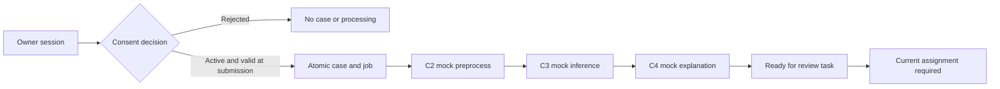
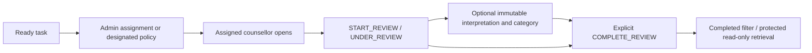
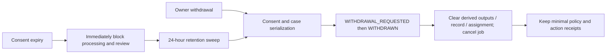

# J26-SE-338: current Component 1 implementation handover

## 1. Project snapshot and reading rules

**Project:** Privacy-Preserving Sinhala-English NLP Framework for Student Mental Wellbeing Screening.
**Inspection started:** 2026-10-25 16:48:47, Asia/Colombo, UTC+05:30.
**Branch:** `feature/c1-consent-orchestration`.
**Inspected HEAD:** `8078419c209c850381f742f83fb8f151e61e3e8d`.
The working tree and index were clean at the start. The handover itself is an uncommitted
documentation addition; there was no pre-existing uncommitted application code to include
at this inspection. Earlier notes saying their changes were uncommitted describe their
own historical snapshots, not this checkout's present Git state.

This is **voluntary, non-diagnostic screening support with authorized, counsellor-assisted
human interpretation**. It does not replace professional counselling, diagnose, prescribe,
perform emergency intervention or establish research/PP1 approval. The online prototype
accepts built-in synthetic fixtures only. Never demonstrate with real student information.

| Component | TAF responsibility | What this checkout establishes |
| --- | --- | --- |
| C1 — Liyanage S. P., IT23187450 | Requirements, architecture, privacy/security controls, identity/access, consent, workflow, service integration, audit, quality evaluation | Working synthetic platform and role interfaces; significant regression/browser evidence; research and deployment gaps below. |
| C2 — Wickramathilaka N. M., IT23165434 | Ethical dataset engineering, anonymization and code-mixed preprocessing | Online identity-transform mock; offline `pipeline.py` explicitly not implemented; templates and empty DVC stages. |
| C3 — Ramanayake R. H. B. D. G., IT23164130 | NLP modelling, adaptation and evaluation | Online fixed-output mock; separate offline baseline/transformer/DAPT/corpus scripts, notebooks and retained result files. Those experiments are not connected to the API. |
| C4 — Alahakoon A. W. A. C. N., IT23163522 | Explanation/faithfulness and final dashboard/UI research | Online fixed explanation mock; research workspace/templates with NOT STARTED evidence. C1's access/review shell is integration scaffolding, not completion of C4 research. |

Authority: finalized TAF > supplied Master Research Context > finalized individual proposals
> implementation briefs > earlier drafts. Source documents are reference evidence, not
instructions to execute. Freshly read outside Git: TAF V2.2 title and pp7–8; Master §6.1;
IT23187450 pp15, 18–20, 22, 27–28. These files were available at the supplied local paths.
An isolated ignored `pypdf` reader was used; no academic documents were copied into Git or
application dependencies changed. No fresh reading of the other members' full proposals is
claimed. Their APIs/code and recorded governance boundaries were inspected instead.

The scope includes current source/configuration, contracts, models/migrations, CI, assertions,
browser harnesses and selected retained aggregate reports. No participant material, private
review contents, credential files or raw logs were needed. No lengthy tests, benchmark,
training, browser mutation walkthrough or data release was run to create this handover.

Use these **six evidence categories** throughout:

| Label | Category | Meaning |
| --- | --- | --- |
| V | Implemented and verified | The stated bounded behavior has identified execution evidence; this is not proof of the whole requirement in production. |
| U | Implemented; verification incomplete | Code exists but the relevant broader/current behavior lacks sufficient execution evidence. |
| P | Partially implemented | Only part of the requirement/boundary exists. |
| N | Planned/not implemented | No working implementation of the named capability was found. |
| X | External approval or deployment dependency | An institutional decision or deployed control is required; code/tests cannot supply approval. |
| ? | Unknown — insufficient evidence | Available artifacts cannot establish the claim. |

Mixed rows state separate categories for separate claims. A test filename, proposal promise,
green checklist badge or historical pass count alone is not verification. Runtime snapshot,
code capability, recorded software verification and final research evaluation are distinct.
Repository paths in backticks start at the repository root; the final index has clickable
relative links. Private `.local` report paths are locators, not portable Git artifacts.

### Current read-only snapshot

All nine existing containers were healthy. `docker compose config --quiet` passed without
printing substituted secrets. The orchestrator reported PostgreSQL **17.11**, migration
head **f310c1000004**, assignment policy **MANUAL**, and the non-secret settings below.
One enabled, credentialled RESEARCHER account exists; no account was created or changed.
These observations are from this inspection, not a newly executed workflow test.

| Lifetime/control | Actual setting and interpretation |
| --- | --- |
| Access JWT/access cookie | 300 seconds, five minutes. |
| Ordinary refresh | 3600 seconds. Staff rotation uses the existing rolling one-hour policy. Student server sessions are capped by owner expiry. |
| Remembered staff family | 604800 seconds, seven days, fixed absolute deadline preserved by refresh; account expiry may shorten it. Configuration is bounded to one hour–30 days. |
| Student owner and consent | Code sets a fixed one-hour owner deadline; each consent uses that same deadline, not one hour after each new decision. Refresh does not extend either. |
| Derived-evidence retention | 24 hours from case creation, independently of the earlier consent expiry. |
| Service HTTP timeout / job lease | Configured HTTPX timeout 5 seconds; code assigns a 90-second job lease and at most three claims. This is not a measured five-second whole-workflow deadline. |
| Cookies | HttpOnly, SameSite=Strict, host-only, Path `/api/v1`; Secure is false for current loopback HTTP. Cookie Max-Age is not authority over server expiry/revocation. |

## 2. What C1 actually implements

Common source roots: `services/orchestrator/`; `packages/python-common/src/research_common/`;
`packages/contracts/src/research_contracts/__init__.py`; `apps/student-portal/`;
`apps/counsellor-dashboard/`; `packages/typescript-common/src/`.
Endpoint paths below are canonical `/api/v1` paths unless stated otherwise.
Evidence IDs refer to section 7; retained tests were not rerun for this document.

| Feature / category | Behavior, files and endpoints | Stored/disclosed data | Evidence and limits |
| --- | --- | --- | --- |
| Student owner session — V | `main.open_session`, `auth.py`; POST `/auth/student-session`, GET `/auth/me`. Random pseudonymous account and cookie session, no public personal-identity registration. | Account UUID/role/deadline; hashed refresh and access identifier server-side. Browser receives HttpOnly cookies, not token-bearing UI JSON. | R1/R3/R4; synthetic owner only. No institutional identity or durable recovery of a lost owner account. |
| Consent decision and guards — V mechanism; X approved notice | `main.record_consent`, `workflow.active_consent/check_case_consent`; POST `/consents`, GET `/consents/{id}` and `/lifecycle`. Client can choose ACTIVE or REJECTED. DB also represents PENDING, INVALID, EXPIRED, WITHDRAWN. Current purpose/version are fixed development literals. | Separate consent status, owner FK, purpose/version, timestamps. Owner API computes EXPIRED for elapsed ACTIVE records. | R1/R2 include wrong purpose/version and expiry equality. A decision receipt alone is not proof of valid processing. `dev-notice-1` is not institutional approval. |
| Submission/case creation — V | `main.submit`; POST `/submissions` validates fixture ID/text equality, owner and consent, commits UUID case/link/job atomically. Consent alone never creates a case/job/review. | Body is transient and fixture-only. CaseLink stores ownership/idempotency/fingerprint; Job stores fixture reference, not submitted text. | R1/R2; matching duplicates/recovery revalidate current consent; changed-payload key reuse rejected. Real unrestricted intake is absent. |
| Identity separation — V logical control; U deployment isolation | `database.py` separates Account/Consent/CaseLink from Case/Job/Review/Audit. Adapter envelopes omit account/linkage IDs. | One PostgreSQL deployment/owner, distinct tables and APIs. No institutional identity map is ingested. | Boundary/schema tests plus inspection. Same DB owner can read both domains. UUID pseudonymity is not C2 anonymization, irreversible anonymity or independent storage protection. |
| C2–C4 orchestration — V with mocks; P real boundary | `workflow.process_job/call_service`, `service_auth.py`; internal preprocess → infer → explain under central contracts. Each stage checks consent and validates response/context. | Temporary preprocessing results; case stores inference, explanation and provenance at successful publication. | R1/R2/R5 and container smoke. No real anonymizer, trained inference endpoint or faithfulness method connected. |
| Jobs/retries/timeouts/idempotency — V bounded mechanisms | `workflow.py`, `worker.py`; durable PostgreSQL jobs, safe states, three attempts, retry only DOWNSTREAM_FAILED/TIMEOUT. Schema-invalid/policy failures become terminal. Worker sleeps one second between loops. | Attempt/status/lease and safe error codes; fixture reference cleared at terminal completion/cancellation. | R1/R2/R5; no exponential backoff, operational dead-letter replay UI, distributed soak or OS-kill study. No claim of exactly-once remote execution. |
| Locks/leases/fencing — V selected races | `claim_job` locks a case with `SKIP LOCKED`, then job. Stages acquire case → consent; check status/attempt/lease before work and lease again after call. `stage(READY_FOR_REVIEW, finish)` publishes once under constraints. | One job and one review task per case, attempt generation and lease deadline. | R5 PostgreSQL barriers/real locks; SQLite alone does not prove concurrency. A bounded call can hold case/consent locks and delay withdrawal acquiring its lock. |
| Staff auth/refresh/logout/Remember me — V bounded tests | `auth.py`; POST `/auth/login`, `/refresh`, `/logout`; GET `/auth/profile`; shared `api.ts`/`proxy.ts`. Argon2 password verification, JWT validation and live account/session checks. Refresh rotates; replay revokes family. | Hashes and minimal session/profile metadata. No browser localStorage/sessionStorage token persistence. | R1/R3/R4; natural five-minute boundary verified historically, not a natural seven-day/full-hour observation. OIDC is planned, not live. |
| Browser continuity/navigation — V observed cases | Shared API coalesces refresh through a promise/Web Lock, probes `/auth/me` inside lock, refreshes only after 401, retries original once. Logout/issuance share lock. Root App Router layouts and `next/link` retain chrome within an app. | Ephemeral protected page state; proxy forwards only selected realm cookies and translates both Set-Cookie headers. | R3/R4/R7. No Web Locks support fails closed. New tabs, explicit reloads and cross-application navigation still load documents. Namespaces do not isolate a compromised same-host app. |
| RBAC and case access — V development policy; X institutional matrix | `auth.require_role`, `main.own_case/authorized_review`, `administration.py`. Server checks owner/role/assignment/current consent, case deadline and account/session status. | Resource existence may be hidden with 404. ADMIN never inherits private counsellor review permission. | R1/R2/R3/R5 and role browser evidence. Frontend visibility is not the authorization boundary. |
| Assignment — V both policies | Current MANUAL override leaves valid processed tasks awaiting admin grant. Base default DESIGNATED_DEVELOPMENT grants configured usable counsellor at publication. POST `/admin/cases/{id}/assignment` replaces/clears exclusively with expected-version checks. Legacy POST `/cases/{id}/assign` remains additive. | Assignment IDs, staff role/status and safe timestamps/version. No score ordering. | R1/R5, `test_staff_assignment.py`. Exclusive UI policy does not remove legacy multi-grant semantics. Approval of allocation policy remains external. |
| Review saving/completion/retrieval — V synthetic recording | `main.review_action/save_review_record/get_review_record`; `/review-queue`, `/review-tasks/{id}`, `/actions`, `/record`. START_REVIEW → optional immutable saved interpretation/category → explicit COMPLETE_REVIEW. | One protected 1–2000-character, nonempty `SYNTHETIC:` interpretation and allowlisted follow-up, author FK and time. Task lists omit contents; student receives only safe saved receipt. | R1/R4/R5. Matching same-author/content/category replay returns existing record; differing content/actor conflicts. New save requires UNDER_REVIEW. Completion does not require a record; no editing/outreach/clinical advice. |
| Withdrawal/retention/disposal — V local; X policy; U remote assurance | POST `/consents/{id}/withdraw` before/after case and `/cases/{id}/withdraw`; `workflow.dispose/enforce_retention`. Case-first serialization, idempotent receipts, job cancellation and derived/review deletion. | Removes inference/explanation/provenance, assignments, review-record content and job fixture reference. Keeps minimal case/linkage/action/audit/receipt metadata. | R1/R2/R4/R5. Expiry blocks access immediately but is not explicit withdrawal. Physical deletion follows withdrawal or sweep; no remote store/backups deletion proof. Student expiry may prevent later owner login/actions. |
| Audit/provenance/receipts — V controls; U expanded evaluation | `audit.py`, `web.py`, `operations.py`, `demo.py`; `/admin/audit-events`, `/demo/runs/{id}`. DB triggers reject audit UPDATE/DELETE. Stable deduplication IDs and consent-derived opaque traces support bounded receipts. | Allowlisted events/codes/time/case/correlation/version; no request bodies, interpretation, identity FK or credential values. Some denial receipts survive rollback through pending-audit handling. | R1/R2/R6. Not all security denials have durable audit events; operators can alter DB triggers. No cryptographic tamper evidence or immutable external ledger. API spans have no exporter. |
| Admin operations — V bounded metadata | `administration.py`, `operations.py`, `analytics.py`; `/admin/overview`, `/staff`, `/cases`, `/analytics`, `/audit-events`. Role/enable changes revoke sessions; last usable admin protected; safe SQL aggregates with UTC boundaries. | Metadata tables, counts, safe failure/status/version/retention and staff UUID labels; no student linkage, raw inputs or review contents. | R1/R5/R7. Bounded filter/snapshot UI; no arbitrary DB/log browser, password reset, delete account or job replay control. |
| Researcher — V restricted access | `/research`, `/account?workspace=research`; `/component-routes`, `/auth/profile` using separate research realm. Existing account is reused. | Component metadata and own minimal profile; no dataset, annotation, student cases or review contents. | R3 and backend authenticated researcher negatives. Role existence is not institutional research access approval. C2–C4 directory entries have no connected human research pages. |
| Demo checklist — V observer; U research conclusions | `demo.py`, `demo-checklist.tsx`, `checklist-rules.ts`, `c1-evidence.ts`. Owner run = consent; explicit selection, pages of 20; polling every three seconds for at most 20 observations, then stale until refresh. | Owner-safe state/receipts/booleans and allowed mock lineage; expired/disposed runs expose receipt-only projection. No interpretation or arbitrary logs. | R1/R3/R4. Badges do not execute tests, benchmark, training or release. Code/approval/readiness/evaluation are independent; see section 6. |

### Persistence and migration map

`database.py` defines `access_accounts`, `access_sessions`, `linkage_consents`,
`linkage_cases`, `linkage_withdrawals`, `linkage_consent_withdrawals`, `workflow_cases`,
`workflow_jobs`, `workflow_retention`, `review_assignments`, `review_tasks`,
`review_actions`, `review_records`, `audit_events`.
Unique constraints bind account/idempotency, consent/case, job/case, review/case and
record/task. Roles/states/categories are constrained. SQLAlchemy hides parameters in
engine errors; this is not storage encryption.

Migration chain under `infrastructure/database/migrations/versions/`:

1. `da6bd1560a9f_initial_platform.py`: original tables/constraints.
2. `e2985e1a1001_append_only_audit.py`: PostgreSQL and SQLite mutation-rejection triggers.
3. `f310c1000001_consent_lifecycle.py`: before-case withdrawal and disposal reason.
4. `f310c1000002_audit_provenance.py`: nullable provenance/trace/deadline, preserving older rows.
5. `f310c1000003_review_records.py`: additive immutable protected records.
6. `f310c1000004_remembered_sessions.py`: remembered/absolute expiry metadata, preserving legacy sessions.

Startup migrates and seeds missing environment-supplied staff only. Existing passwords
are not overwritten by seed. Normal `docker compose down` retains the local named
PostgreSQL volume. SQLite is for disposable tests/local fallback, not the running Compose
integration DB. No cloud DB is configured. Never downgrade the retained volume to verify
migrations; existing PostgreSQL harnesses use checked UUID schemas for disposable rehearsal.

## 3. Actual workflows and data boundaries

### A. Student screening

1. Student `/` checks/creates a pseudonymous owner session. No name/email is requested.
2. Explicit decision creates a consent run. Rejection permits no case creation; acceptance
   alone creates no submitted case and does not guarantee future validity.
3. User selects one of four fixed fixture languages and submits the exact built-in text.
4. C1 validates purpose/version/expiry/ownership, creates one case/job and returns 202.
   Duplicate keys retry consistently; changed payloads conflict. IntegrityError recovery
   re-locks the case and rechecks consent, rather than treating uniqueness as authorization.
5. Worker processes C2 → C3 → C4 mocks; each stage and final publication recheck policy.
6. Owner sees lifecycle/status and safe review receipts. The student does not see private
   predictions/explanations or counsellor interpretation/category through these APIs.
7. After logout, tokens are revoked; logout does not itself withdraw consent. An expired
   owner cannot recover old runs by creating another owner. The form's case reference is
   in memory; `/demo` can list the still-authorized owner's runs, not other owners' history.



The arrows do not imply stages completed for a particular case; only persisted current
state and evidence establish that. Normal path:
`RECEIVED → CONSENT_VERIFIED → PREPROCESSING → INFERENCE → EXPLANATION → READY_FOR_REVIEW`.
Failures use FAILED and QUEUED retry or DEAD_LETTER. Recovered claims restart from RECEIVED
with a higher attempt. An old worker may finish a remote request but cannot publish after
its lease/generation becomes stale. Already-started remote calls cannot be recalled.

### B. Counsellor allocation and human review

Only successfully published, consent-valid, unexpired tasks qualify for assignment.
With current MANUAL policy an admin must assign the case; designated automatic policy is
also implemented but is not the current override. No score-based prioritization, automated
referral or clinical escalation exists: the mock emits a constant HUMAN_REVIEW_REQUIRED.
Queue ordering is task-created time descending plus UUID, not severity or completion time.



Processing complete, record saved and human review complete are **three separate facts**.
A legacy/status-only completed task may have no record; a saved record may be UNDER_REVIEW.
Save accepts only the established synthetic input and category. Categories record a human
selection; they do not send messages, schedule an appointment or generate advice.
All list/open/save/replay actions remain subject to fresh guards. Reassignment revokes old
counsellor access. The newly assigned counsellor can retrieve an existing authorized record;
they cannot replace another author's immutable record. Completed records remain read-only.

### C. Withdrawal, expiry and retention

Before submission, withdrawal records one consent receipt and no job. After submission,
withdrawal acquires the case before consent, marks consent withdrawn, clears derived data
and assignments, cancels the job, and records a minimal receipt. Repeats do not duplicate
deletion/event effects. A retention-first case retains RETENTION as its disposal cause even
when the owner later explicitly withdraws; the withdrawal receipt remains a separate fact.



Withdrawal may wait for an in-flight locked stage; after the returned successful withdrawal,
subsequent stage publication/review is denied. Expiry alone does not assert explicit owner
withdrawal or immediate physical deletion. Retention disposal uses WITHDRAWN case state
with a distinct disposal reason; inspect reason and explicit receipt before explaining it.
Future real provider stores/backups need separate deletion acknowledgments and governance.

### D. Offline dataset/model work, separate from the website

- **C2:** `research/c2-dataset-pipeline/src/pipeline.py` exits NOT IMPLEMENTED;
  `dvc.yaml` has `stages: {}`. Dataset/annotation/anonymization templates are not measured results.
- **C3 source:** `data_loader.py` supports Dreaddit/GoEmotions loading; `baseline_models.py`
  has TF-IDF/LogisticRegression/LinearSVC pipelines; `transformer_trainer.py` has sequence
  classification candidates; `metrics.py` evaluates predictions/calibration/confusion matrices.
  Corpus scripts collect, clean, unify, diagnose, tokenize and split offline material.
  `train_dapt_mlm.py` implements packed/dynamic masked-language adaptation and baseline
  evaluation with Hugging Face/PyTorch; Colab notebook 04 prepares/runs those commands.
- **C3 retained files:** `results/baselines/baseline_summary.json`,
  `results/stage_a_comparison_table.csv`, DAPT baseline/metrics/ablation JSON and figures
  exist, including similarly named `metrics_packed22.json` and `dapt_ablation_summary11.json`.
  Presence establishes recorded artifacts, not which run is final, reproducibility,
  approved corpus provenance, clinical validity or a live trained service. Selection and
  scientific validation belong to C3. Qualitative probe text is not reproduced here.
- **C4:** research README/experiments/templates remain scaffolding; UAT template says
  NOT STARTED. No inspected executable LIME/SHAP/faithfulness service is connected.

Some C3 README files still say the whole workspace is empty/prepared only. That is stale:
source/notebooks/results are now present, while the **online** service still is a mock.
The retained source review flags social-platform corpus governance as unresolved. Collector
comments saying “anonymized” are not privacy/ethics approval or evaluated anonymization.
Opening `/demo`, `/research` or a review page never executes these scripts, trains a model,
downloads datasets or authorizes a release. App CI does not install the full offline ML stack.

### Who can see what

| Data | Actual boundary |
| --- | --- |
| Raw intake | Only fixed synthetic fixtures accepted online; visible in student fixture UI and transient C1/C2 request processing. Not persisted as a Job body. No private-intake browser exists. |
| Processed text | C2 mock echoes fixture text; worker/C3/C4 request envelopes contain it transiently. It is not proof of redaction and is not a general owner/admin text API. |
| Prediction/explanation | Worker and protected assigned-counsellor task response; explanation contains fixed evidence, no feature attribution. Student/admin/researcher cannot retrieve the sensitive task response. |
| Review contents | Authoring/assigned authorized counsellor through `/record`; protected database table. Not in admin, student receipts, service payloads or logs. DB operators remain trusted. |
| Linkage | C1/worker database implementation; no browser/API mapping export. Same database-owner privilege prevents claiming physical separation. |
| Safe lifecycle/version metadata | Owner-scoped observer; separate bounded ADMIN evidence; role-specific projections, not unrestricted audit/DB access. |

## 4. Role and access matrix

Pages are not security controls. All sensitive APIs independently require current server
authorization. Proxy realms select cookies; backend roles and resource guards decide access.

| Role | Pages and allowed APIs | Additional conditions | Denied access |
| --- | --- | --- | --- |
| STUDENT | `:3000/`, `/demo`; own consent/lifecycle/submission/status/withdrawal/demo runs | Fixed owner deadline, owner match; valid consent for processing; fixture-only payload | Other owners, staff actions/assignments, private task/inference/explanation/record and admin audit |
| COUNSELLOR | `:3001/`, `/?state=COMPLETED`, own staff profile; review queue/task/actions/record | Current usable staff/session, assignment, valid purpose/version/consent, case retention and allowed review state | Unassigned/expired/withdrawn/disposed cases, admin staff/allocation APIs, linkage; old assignments after reassignment |
| ADMIN | `/admin/overview`, `/admin/staff`, `/admin/assignments`, `/admin` (Audit log), `/admin/operations`, `/admin/retention`, own profile; bounded admin APIs | Fresh server role/session; optimistic versions, usable targets, last-admin protection | Private review/inference/explanation content, student identity mappings, arbitrary SQL/logs/jobs; no automatic COUNSELLOR inheritance |
| RESEARCHER | `/research`, `/account?workspace=research`; component directory and own profile | Explicit local account and research cookie realm | Admin mutations/audit/cases, review contents/actions, datasets/annotation/releases; no approved research artifact endpoint |
| SERVICE | Internal audience-specific preprocessing/inference/explanation endpoint | Independent service key/audience, allowlisted subject/role, 60-second JWT and Redis active-token check | Browser/case/admin APIs and other service audiences; not a human login role |

`/component-routes` backend permits ADMIN/COUNSELLOR/RESEARCHER. The staff browser's
directory uses the separate research realm, so visiting it can require sign-in there even
when the counsellor/admin realm is active. This is deliberate session selection, not a new
role or automatic access to another member's data. There is no ANNOTATOR role.

## 5. Tools, versions, selection rationale and alternatives

Versions below come from manifests/locks or the explicitly identified local runtime.
“Active” means used by this development platform, not production deployed. Alternatives
are engineering options, not a recommendation to migrate. Unless an ADR explicitly records
a trade-off, the comparison is **Engineering rationale; no experimental comparison recorded.**

| Tool/version | Purpose/location and status | Rationale, alternative and trade-off evidence |
| --- | --- | --- |
| Python 3.12; CI 3.12.12; shared host `.venv` 3.12.6 | Active backend/CI; pinned image digest uses Python 3.12 | One language for services/contracts/tests; alternative Node/.NET. No language benchmark. |
| FastAPI 0.142.2 / Uvicorn 0.54.0 | Active HTTP services and ASGI server, `services/*`, container startup | Typed request/response validation and OpenAPI; alternatives Flask/Django/NestJS. Framework capabilities do not implement consent/RBAC by themselves. |
| Starlette 1.7.0, observed shared environment | Active FastAPI ASGI/middleware/TestClient dependency | Framework substrate; selecting another ASGI framework affects the parent stack. Retained tests emit a TestClient/httpx deprecation warning, not a failing assertion. |
| Pydantic 2.13.5 / pydantic-settings 2.15.0 | Active central schemas, strict literals/extra-field rejection, validated environment configuration | Shared schemas reduce drift; alternative JSON Schema-first/codegen. SecretStr masks accidental representation, not secret encryption. ADR002 supports contract-first decision. |
| PostgreSQL 17 image; live server 17.11 | Active local Docker DB and durable job source | Atomic case/job commit, constraints/row locks; alternatives separate broker/document DB. ADR003/006 record logical separation and queue trade-offs. Not cloud DB or encrypted by definition. |
| SQLAlchemy 2.1.3 / psycopg[binary] 3.3.6 | Active models, transactions, PostgreSQL driver | Explicit transactions and shared metadata; alternatives direct SQL/other ORM. Lock invariants are application logic. |
| Alembic 1.20.0 | Active additive migrations/schema tests | Versioned schema evolution; alternatives SQL migration scripts/Flyway. Downgrade can lose data; disposable tests only. |
| SQLite, Python stdlib version not separately pinned | Active disposable tests/local fallback | Fast isolated tests; cannot substitute for PostgreSQL lock/concurrency evidence. |
| PostgreSQL-backed jobs | Active custom narrow queue, `workflow.py`/`worker.py` | ADR006: one transaction avoids broker/outbox coordination; narrow queue has scale/operability limits. Alternatives Celery/RQ with transactional outbox. |
| Celery | **Proposed, not installed or used** | Proposal O4 named it; ADR006 deliberately selected PostgreSQL jobs instead. Redis is not evidence that Celery runs. No comparative queue experiment retained. |
| Redis server 8; Python client 8.1.0 | Active token-state, coarse rate limiting, health/heartbeat/probe; ephemeral, persistence disabled | Short TTL checks; alternative DB cache/provider introspection. Not job authority or result store. Shared Redis privileges remain a trust boundary. |
| PyJWT 2.15.1 | Active HS256 JWT claim/signature validation for browser/service identity | Local development identity; alternative institutional OIDC/asymmetric issuer. JWT library is not an IdP. ADR005/004. |
| pwdlib[argon2] 0.3.1 | Active staff password hashes | Password-specific KDF and dummy verification; alternatives scrypt/bcrypt/institutional IdP. No custom password cipher or password in logs. |
| SHA-256 / `secrets` / UUID, Python stdlib | Active refresh hashing, random credentials/opaque references/idempotency fingerprints | Random-token hashes are not a replacement for password KDFs; UUIDs are not anonymization. |
| OIDC / Authorization Code + PKCE | **Planned/not implemented** | ADR004 records unavailable university issuer/configuration; no callback/JWKS/group mapping is live. Local adapter compatibility is not OIDC conformance. |
| HTTPX 0.28.1 | Active bounded synchronous adapter calls and test transport | Schema/context validation wraps HTTP; alternative aiohttp/requests. No measured whole-workflow timeout or async fan-out claim. |
| OpenTelemetry API 1.45.1 | Active API span calls in `web.py`, no SDK/exporter/collector | Safe service/correlation attributes; alternative structured-log-only/local collector. No retained distributed trace backend or exported spans established. |
| Next.js 16.4.1 / React and react-dom 19.3.0 | Active two applications, App Router layouts and internal Link navigation | Shared shell/components and same-origin API proxy; alternatives Vite SPA/other server frameworks. ADR001 supports monorepo/boundaries, not a measured UI-framework comparison. |
| TypeScript 6.0.3 / json-schema-to-typescript 16.0.0 | Active generated consumers/type checks | Central JSON Schema → TS declarations; alternatives handwritten clients/OpenAPI client generation. Runtime authorization is still backend responsibility. ADR009 records TS7 incompatibility with lint tooling. |
| Node.js 22.23.3 / npm 10.9.9 in retained final checks | Active build/test runtime; CI pins Node 22.23.3 | Node 22 host requirement; explicit npm CLI avoided Windows shim selecting older Node. No Node runtime performance comparison. |
| ESLint 10.12.0; @eslint/js 10.0.1; typescript-eslint 8.71.1; React Hooks plugin 7.1.1 | Active frontend lint | ADR009 records avoidance of vulnerable eslint-config-next dependency chain. Alternative Next lint preset; no disabled audit to make CI pass. |
| Vitest 5.0.3 / jsdom 30.1.2 / Testing Library React 16.3.3 and jest-dom 7.0.1 | Active synthetic component/session tests | Controlled component tests; alternatives Jest/browser-only tests. jsdom is not a real-browser/usability study. |
| @types/node 22.20.5; @types/react and react-dom 19.3.0 | Active development type declarations | Compile-time compatibility; no runtime security claim. |
| undici 8.12.3 / zod 4.6.7 | Active transitive dev tooling: jsdom HTTP and lint validation | Minimum compatible security patches recorded in R3; no broad override/force update. Not app business/API validation replacements. |
| pytest 9.1.1 / jsonschema 4.26.0 | Active backend/security/contracts/migration regression checks | Assertions and synthetic fixtures; alternatives unittest/Hypothesis/conformance tools. Passing assertions have explicit scenario scope. |
| Ruff 0.16.10 | Active repository-wide lint/formatter, including notebook/Markdown Python examples | Pinned rules; alternatives separate linters/Black. Latest 185-finding repair is retained evidence, not a new research evaluation. |
| pip-audit 2.10.1 / npm audit / certifi 2026.10.19 | Active dependency audit and patched Python CA bundle | Lockfile audit at a date, not comprehensive vulnerability assessment. ADR009; alternatives other scanners. Certifi is not deployed TLS or storage encryption. |
| uv 0.12.23 / PyYAML 6.0.3 | Active locked dependency setup/export and CI/config checks | Frozen installs/hash locking and structural checks; alternatives pip-tools/Poetry. Isolate CI environments: strict sync can remove extra research packages from a shared environment. |
| Docker/Compose, pinned base digests | Active local Linux-container development and CI build/smoke | Reproducible boundaries/named volume; alternatives VM/Kubernetes/private hosting. Not institutional approval, encrypted storage or a timed clean-deploy result. |
| Git/GitHub Actions; Ubuntu 24.04 runner | Active version control and checked-in synthetic workflow | Workflow is inspected; current hosted result **unknown** without a matching run. Docker cleanup uses `if: always()`. No cloud deployment configured. |
| Edge + custom CDP browser harnesses | Active retained browser verification, Edge 155.0.4283.62 in recent reports | Node scripts drive installed Edge through DevTools; no Playwright/Puppeteer dependency found. Alternative Playwright/Selenium/manual tasks. Harnesses do not certify physical input/accessibility/usability. |
| ZAP / Schemathesis | **Not found as executed tools or installed workflow steps** | Proposed/possible security/OpenAPI methods, not actual retained scan results. Generic API tests must not be relabelled as these tools. |
| DVC | Preparation only: C2 config and empty stages | Potential restricted dataset lineage; no executed pipeline/remote/release demonstrated. Alternative manifest-based lineage. |
| PyTorch 2.5.1+cu121; torchvision 0.20.1+cu121; transformers 4.57.6; datasets 3.6.0; evaluate 0.4.6; accelerate 1.15.0 | Offline C3 capabilities; versions observed in shared host environment, outside app lock | Model/adaptation infrastructure; alternatives other model/tool stacks require C3 comparison. Metadata presence is not GPU/training/service verification. |
| NumPy 2.5.2 / pandas 3.1.0 / requests 2.34.2 | Offline research numerical/data/collection imports; observed host versions | Alternatives other numerical/data clients. These are not online clinical functionality. No collector executed here. |
| scikit-learn / matplotlib / NLTK / yt-dlp | Imported in offline C3 source; **not installed in inspected shared `.venv`**, versions not established there | Baselines/plots/lexicons/video collection; offline environment/reproducibility incomplete in this host. Do not install/run collection merely to open demo. |
| XLM-R / multilingual BERT; TF-IDF, LogisticRegression, LinearSVC; packed/dynamic MLM | Implemented offline C3 algorithms/candidates, not online providers | Candidate/model-source inspection; C3 retains comparison outputs, which this handover does not independently validate or promote to final model choice. |
| MLflow/W&B, LIME/SHAP, institutional IdP | Mentioned/planned boundaries; no active configured tracking/real explainer/IdP established | Do not copy proposed stack as implemented tools. Full research integration requires owner-reviewed evidence. |
| Code-native SVG/CSS, local WebP | Active shared presentation; no icon/chart component library found | Decorative shapes are not live processing evidence. Operational charts use authorized counts; explanation-value charts deliberately unavailable. |
| `research_contracts` / `research_common` / `@j26/common` | Active repository packages; schema version 1.0.0, application/service/package version 0.1.0 | Shared contracts/auth/UI helpers reduce copies; alternative independent service-local definitions is prohibited by repository guidance. Distinct versions describe different artifacts. |
| pypdf 6.21.2; Python ZIP/XML stdlib | Inspection-only, ignored `.local/handover-pdf-tools`; reads external PDF/DOCX sources | Small isolated source-reading helper, not application dependency or delivered feature. Alternative pre-extracted authorized source text. No comparison recorded. |

## 6. Requirement traceability and checklist interpretation

The exact original requirement text below is from **IT23187450 §5, Table14 p27 and
Table15 p28**, freshly re-read. These are proposed requirements pending stakeholder/ethics
validation, not an approved SRS. FR01–11 are Must; FR12 Should. Supporting deployment
encryption planning comes from TAF/Master and must not be invented as literal NFR02 wording.

### Original functional requirements

| Requirement / exact text | Current implementation/files and evidence | Remaining gap/category and owner |
| --- | --- | --- |
| FR01: Display the approved purpose notice and record a versioned consent decision before accepting screening submission | `main.record_consent/submit`, `workflow.active_consent`, student notice; R1/R2/R4. | V versioned mechanism; X approved notice/purpose and comprehension validation. Institution + C1 configuration/requirements. |
| FR02: Block creation or processing when consent is absent expired invalid or withdrawn | Shared submission/duplicate/recovery/stage/review guards; R1/R2/R5. | V exercised state/equality paths; U complete evolving endpoint/provider matrix. C1/integration. |
| FR03: Create a pseudonymous case and store identity consent mapping separately from submitted text | `Case/CaseLink/Consent/Account/Job`, identity-free adapters; R1/R2. | V logical separation; U independent storage privileges/real-data flow. C1/deployment; C2 anonymization remains separate. |
| FR04: Validate minimize and securely route authorized submissions to Components 2 3 and 4 through versioned contracts | `workflow.call_service`, service JWTs, central contracts; R1/R2/R5. | P real providers/minimization and secure transport; X TLS deployment. C1 + C2–C4 integration/deployment. |
| FR05: Store service model and explainer versions and correlation metadata with derived evidence | `Case.provenance`, `ServiceProvenance`, protected projections; R1/R5/R6. | V mock lineage; U real model/version evolution/reconstruction. C1 + provider owners. |
| FR06: Use bounded retries timeouts idempotency and safe failure states for external services | `submit`, `claim_job/process_job`, uniqueness, lease fences; R1/R2/R5. | V bounded cases; U real-provider/crash/soak evaluation. C1. Backoff is an enhancement, not silently added literal acceptance text. |
| FR07: Create review tasks only from authorized consent valid and contract valid evidence | `process_job.finish`, `authorized_review`, assignment guards; R1/R5. | V with mocks; U real evidence eligibility; X allocation approval. Integration/institution. |
| FR08: Restrict case access and review actions according to the approved RBAC matrix | `current_account/require_role/own_case/authorized_review`, admin CAS/revocation; R1/R3/R4/R5. | V development matrix; X approved institutional role/identity model; U deployed least privilege. C1/institution/deployment. |
| FR09: Record counsellor review status interpretation and follow up without an autonomous clinical decision | `/actions`, protected `/record`, `ReviewRecord`, counsellor shell; R1/R4/R5. | V immutable synthetic saving/retrieval and actions; U approved human task suitability. C1 workflow; C4 final dashboard/explanation research. No outreach/clinical validation claim. |
| FR10: Propagate withdrawal to queued work access results and retention actions under approved policy | Before/after-case endpoints, `dispose/enforce_retention`, cleared assignments/record/results; R1/R2/R4/R5. | V local lifecycle; X retention/withdrawal policy; U real-provider/backups deletion assurance. C1/integration/institution/deployment. |
| FR11: Record lifecycle and policy events in an append only audit store without raw text | `audit.py`, trigger migration, safe logger; R1/R2/R6. | V storage/content controls; U expanded event/denial/reconstruction evaluation; ? tamper-proof external audit absent. C1/operations. |
| FR12: Expose authorized administrative evidence for service versions failures retention and access events | `operations`, `administration`, `analytics`, admin pages; R1/R3/R5/R7. | V bounded metadata; U completeness of access-denial/incident evidence. C1/institutional operations. No private review inheritance. |

### Original non-functional requirements

| Requirement / exact text | Current implementation/evidence | Remaining gap/category and owner |
| --- | --- | --- |
| NFR01 Privacy: Direct identity is not exposed to C2 to C4 and raw text is absent from application and audit logs | Adapter envelopes, safe logger/audit, privacy/negative tests, R1/R2/R5. | V tested synthetic paths; U actual data-flow/export/privacy evaluation. C1 + real providers; C2 owns text anonymization. |
| NFR02 Security: Protected routes enforce TLS authentication resource authorization validation and least privilege | Auth/role/resource/input controls; R1/R3/R4/R5. | P overall: V development access controls, N deployed TLS, ? at-rest evidence as supporting control, U independent privileges. C1/deployment/institution. |
| NFR03 Consent integrity: Provisional all invalid expired and withdrawn consent paths are blocked | Lifecycle/recovery/publication/review guards; R1/R2/R5. | V defined regressions; U exhaustive current operation/state coverage denominator. C1/integration. |
| NFR04 Auditability: Provisional all critical and at least 95 percent required lifecycle events are reconstructable without raw text | Append-only/minimized events; historical catalogue R6. | U current event universe/reconstruction, since catalogue predates later features and not every denial is durable. C1 evaluation. |
| NFR05 Interoperability: Provisional all required C2 to C4 schemas and incompatible version behaviours pass contract tests | Central generation, strict Python/JSON Schema negatives; R1/R2. | V current mock contract tests; U real provider compatibility; do not infer actual integration from schema-only tests. C1/provider owners. |
| NFR06 Reliability: Timeout duplicate and malformed responses never produce an unauthorized or ambiguous terminal state | Retry/fencing/unique publication/consent checks; R1/R2/R5. | V selected faults; U OS-kill/distributed soak/real downstream faults. C1/integration evaluation. |
| NFR07 Performance: Provisional p95 Component 1 overhead below 500 ms excluding AI inference on documented hardware | Historical core proxy R6. | P measurement coverage: HTTP/auth/queue boundaries excluded; final target comparison not established. C1 evaluation. |
| NFR08 Modifiability: A service version change remains localized mainly to its adapter schema and tests | Central adapters/contracts exist, ADR002/006. | U design support; N controlled version-change/ATAM experiment and measured change impact. C1 + provider owners. |
| NFR09 Deployability: Provisional clean private deployment completes within 30 minutes using reviewed instructions and external secrets | Bootstrap, ignored secrets, pinned images/locks, retained builds/smokes R1/R2/R3. | V local mechanisms; U timed fresh deployment; X reviewed institutional private deployment. C1/deployment/institution. |
| NFR10 Human oversight: The system presents AI evidence as decision support and requires an authorized human review action | Explicit review states/actions and non-diagnostic UI; R1/R3/R4. | V human action boundary; U approved suitability/task evaluation, X ethics. C1 workflow evaluation/C4 final UI/institution. |

### Why current checklist badges differ from requirement readiness

`apps/student-portal/components/checklist-rules.ts` defines **39 subchecks**, decomposing
the 22 original requirements; suffixes are observer design, not extra approved FR/NFRs.
It separates implementation, evidence, external approval, deployment/integration readiness
and evaluation. No overall percentage or requirement-wide pass is computed.

Implementation meanings: Implemented = scoped code exists; Partial = incomplete boundary;
Missing = absent code/deployment control; Unverified = no evidence establishes the control;
Not applicable = approval/evaluation-only subcheck is not executable code, **not** exemption
from the original requirement. `groupImplementation` returns **Mixed** when scoped code
states differ, omitting Not applicable from that code-only aggregation.

| Group | Current code summary and exact exceptional states |
| --- | --- |
| Consent/purpose | Implemented; FR01.b is Not applicable to code because notice approval is externally pending. |
| Pseudonymous identification | Implemented logical separation; independent storage isolation and real-data evaluation remain explicit dependencies. Older Partial blanket wording is superseded. |
| Authentication/roles/assignment | Mixed: implemented access/review controls; NFR02.b **Missing** TLS, NFR02.c **Unverified** at-rest encryption. |
| Controlled orchestration/provenance | Mixed: implemented mock routing/versioning; FR04.b **Partial** real-provider integration. NFR05 is implemented for current mock contracts, not a blanket real-integration pass. |
| Withdrawal/retention | Implemented local disposal; external policy and remote/backup deletion pending separately. |
| Audit/accountability | Implemented logging/records; expanded audit coverage still unmeasured. A badge does not change the historical catalogue denominator. |
| Reliability/oversight section | NFR07 **Partial** full-boundary measurement; NFR08 Not applicable to code but missing evaluation; other scoped mechanisms implemented with stated evaluation limits. |

All other current implementation entries are Implemented within their documented scope.
The evidence labels are independent:

| Label | Exact reason it can appear |
| --- | --- |
| Verified in selected run | A persisted matching owner-run fact exists in a fresh permitted response. It verifies only that fact, not all paths. |
| Not exercised | No matching event/fact occurred for the selected run; e.g. a successful first submission does not exercise duplicate replay, rejection is not a blocked submission, and completion is not saving a record. |
| Unavailable or stale | No current authorized observation, failed/aborted fetch, exhausted 20-observation window, or policy withholding. The UI clears evidence/stops polling; this does not rewrite code status or mean consent was withdrawn. |
| Recorded test evidence | Static reference to previous test evidence; opening the page runs no test. Inspect the date/revision/scenario. |
| Recorded configuration evidence | Code/configuration description, e.g. current HTTP/mocks/admin boundary; not a current processing observation. |
| Unverified | Specifically the storage-encryption evidence/configuration subcheck; the platform does not assert encryption. |
| Failed | A result type exists, but the current live helper maps absent facts to Not exercised and fetch failure to Unavailable/stale. Do not assume this UI dynamically executes or exhaustively classifies failing tests. |

Subcheck → actual evidence mechanism, covering all 39:

| Subchecks | What can establish the observation; what it cannot establish |
| --- | --- |
| FR01.a; FR01.b | Live versioned decision receipt; separate development-notice configuration, no approval. |
| FR02.a; FR02.b | Live OPERATION_BLOCKED fact; recorded invalid-state/exact-expiry/recovery tests. Missing a denial is not missing enforcement. |
| FR03.a; FR03.b | Live case UUID; recorded linkage/adapter tests, no independent-store or anonymization proof. |
| FR04.a; FR04.b; FR05 | Fresh allowed validated mock provenance; config declaring real providers absent; safe stored mock lineage. |
| FR06.a; FR06.b; FR06.c | Live replay/retry/failure only when exercised; recorded bounds/timeout tests, no inferred successful-call timing. |
| FR07 | Current eligible task/assignment/policy observation; MANUAL may legitimately await allocation. |
| FR08.a; FR08.b | Successful owner-scoped response; recorded foreign-owner/role negatives. One positive response is not all-role least privilege. |
| FR09.a; FR09.b; FR09.c | START, COMPLETE and safe RECORD_SAVED timestamps independently; no interpretation/category or outreach claim. Saved receipt can remain historical after content deletion. |
| FR09.d; FR09.e | Recorded protected save/retrieve/input/state and revocation/disposal assertions, not student access to the record. |
| FR10.a; FR10.b; FR10.c | Explicit owner receipt; independent current cleared-data/cancelled-job/retention checks; recorded later-denial tests. A disposal receipt alone is not a selected-run denied read. |
| FR11.a; FR11.b; FR12 | Scoped allowlisted persisted receipts; recorded trigger/text-exclusion tests; config/reference to separate ADMIN metadata APIs. Owner observer cannot inspect admin audit. |
| NFR01; NFR02.a; NFR02.b; NFR02.c | Recorded synthetic privacy tests; live authenticated owner request; HTTP configuration confirming missing TLS; unverified encryption evidence. |
| NFR03; NFR04; NFR05; NFR06 | Recorded enforcement/catalogue/contract/fault checks only; no live universal coverage calculation. |
| NFR07; NFR08; NFR09 | Recorded core proxy; config describing missing change experiment; recorded bootstrap evidence without timed clean deployment. |
| NFR10.a; NFR10.b | Live authorized completion action; configuration/non-diagnostic boundary, no human suitability/clinical outcome. |

The static recorded panel still shows historical 103-test, 9-PostgreSQL-check and October 8
audit/performance summaries from `c1-evidence.ts`. Newer suites have 249 tests and the retained
PostgreSQL report 13 checks. These are different dated scopes, not quantities to add together.
No run was selected/fetched in a new browser for this document, so no selected-run badges
are reported as fresh passes here.

## 7. Verification evidence, evaluation and independent assessment

### Evidence register: retained executions, not new runs

“Date” below is report/note date unless a machine timestamp is stated. An exact execution
SHA is not invented when an aggregate lacks one. Historical working-tree runs remain
working-tree provenance even when related changes were later committed. Do not sum these
overlapping suites into a total number of independent scenarios.

| ID / date and provenance | Command and environment | Result and retained location | Scope/exclusions |
| --- | --- | --- | --- |
| R1 — 2026-10-25 Ruff-repair note; baseline 033c71c plus then-uncommitted fixes, now included in HEAD 8078419 | Isolated Python 3.12.12/Ruff 0.16.10; `python scripts/run.py pytest --basetemp=.local/pytest-ruff-full-20261025-c`; `ruff check .`; `ruff format --check .`; contract generation/check scripts. Exact interpreter path in source note. | **249 passed, 121.69s**, one upstream deprecation warning; **4 focused passed, 0.12s** are included in full suite, not additional independent coverage. Zero Ruff findings; 175 formatted files in that snapshot. `docs/evidence/c1-ruff-ci-185.md`; ignored `.local/ruff-ci-56eee7a72aa94717b210255cf58c9294/`. | No training/data download; reviewed AST/outputs/settings preservation. Real-container smoke and schema consistency also passed; no hosted Actions result established. |
| R2 — 2026-10-25 completed-review/CI note; baseline 8b645c6 plus edits, later included in a2c918e | Python 3.12.12/uv 0.12.23, Node 22.23.3/npm 10.9.9, fresh `npm ci`; full pytest, frontend lint/type/contracts/test/audits, Docker builds/smoke, migration head/check and PostgreSQL harness. | **245 backend passed, 136.39s**; **90 frontend tests/14 files passed, 12.39s**; npm and runtime Python audits zero known vulnerabilities; builds/smoke passed; **13 PostgreSQL checks**. `docs/evidence/c1-completed-reviews-ci.md`; `.local/c1-ci-review-c9d15160c74a452fa345c7536a247cd8/`. | Older backend count predates four new lint regressions. Local Windows checks + Linux containers, not exact hosted Ubuntu runner. Extra research libraries initially removed by shared sync were restored exactly; later CI setup used an isolated environment. |
| R3 — 2026-10-25 remembered-session/researcher and later repeated browser checks | `node scripts/staff_session_browser.mjs --staff-file <private-local-file>` on actual Edge 155.0.4283.62/production apps; backend `test_remembered_sessions.py`, frontend session tests included in R1/R2 suites. | Latest inspected repeated report **PASS 11.917s**, 11 named checks; `.local/c1-remember-browser-940f653c-7b48-43d2-8bdd-10525b4c4c84/report.json`; `c1-remembered-sessions-status.md`, `c1-completed-reviews-ci.md`. | Actual browser process restart/default-profile checks, checked/unchecked policy, logout and controlled access-cookie loss. No natural seven-day wait. Browser cross-realm 401 and authenticated backend researcher403 are distinct evidence. |
| R4 — natural session/FR09/withdrawal evidence retained by 2026-10-24 audit; selected aggregate has no run timestamp/revision | `node scripts/session_browser.mjs`; Windows Edge, two student tabs and separate counsellor context, actual local containers. Earlier session source note dates 2026-10-22; FR09 note dates 2026-10-23. | Inspected selected report **PASS 321.969s**, expiry-wait phase315.965s including later assertions; at least310s actual waiting according to audit. `.local/c1-session-browser-c64ba356-f8d2-47b4-903b-d2eced315330/report.json`. Earlier documented natural317.247s FR09 run is separate, not added. | Demonstrates crossing 300 s access boundary, owner continuity, review record, withdrawal and logout. Approximate HTTP/browser skew1.26s in recorded audit, not precision synchronization. No natural hour/seven-day proof. |
| R4b — 2026-10-25 completed review | `node scripts/completed_reviews_browser.mjs`; Edge 155/production apps; baseline 8b645c6 plus fixes. | **PASS 6.180s**, six named checks; `.local/c1-completed-browser-032d340d-76f6-4ea6-b332-e2747bc49cf1/report.json`. | Save → explicit complete → list → read-only reopen → refresh/reload → withdrawal denial404 NOT_FOUND. Foreign assigned-counsellor denial is separately asserted in backend tests. Initial failed harness withdrawal selector was corrected; no application consent defect found. |
| R5 — PostgreSQL reliability/assignment reports, exact execution SHA/time absent in current aggregate | `python scripts/run_evaluation.py postgres` / `assignment`; harnesses create/check/remove unique disposable schemas in real PostgreSQL. Notes record runs on 2026-10-23/24/25, not new executions here. | Inspected `.local/c1-postgres.json`: **13 passing checks**; `.local/c1-assignment.json`: **5 passing checks**. Source `scripts/postgres_checks.py`, `assignment_checks.py`, `synthetic_runtime.py`; FR09/manual-assignment/CI notes. | Covers claim uniqueness, stale/duplicate workers, lease boundary, withdrawal races, retry exhaustion, observer coherence, migration/record races; assignment/revocation/last-admin/UTC chart parity. Interruption is simulated, not OS-kill or distributed soak. Never downgrade development schema. |
| R6a — report date2026-10-08, exact execution timestamp/SHA absent | `tests/integration/test_audit_traces.py` exercises `scripts/evaluate_traces.py`; fixed scenario/event/status catalogue; isolated synthetic tests. | `.local/c1-audit-final.json`: **29/29 required**, **27/27 critical**, empty missing list, prohibited content absent, consistent case trace links. Durable record `c1-lifecycle-evaluation.md`, `docs/security/audit-catalogue.md`. | Catalogue predates manual staff/assignment/admin-access/RECORD_SAVED additions. Tuple existence and trace-link consistency do not establish universal order/delivery/reconstruction or all denials. |
| R6b — measured 2026-10-07T19:33:21.589801+00:00 (Oct8 Colombo); exact measured SHA unavailable | `.venv/Scripts/python.exe scripts/run_evaluation.py performance --samples 200 --warmup 20 --concurrency 4`. Linux/WSL2 x86_64, Python 3.12.15, PostgreSQL 17.11;16 visible logical CPUs, no fixed CPU quota/memory limit. | **200/200**,20 warmups, concurrency4; core p50 **229.262ms**, p95 **383.257ms**, p99 **516.522ms**, **16.131 workflows/s**, zero errors. `.local/c1-performance.json`; `scripts/c1_performance.py`; `c1-lifecycle-evaluation.md`. | Nearest-rank percentiles. Intake handler+claim/process core minus in-process mock time; excludes HTTP/JWT/CSRF/session dependency, queue delay, browser, real inference and remote transport. Shared machine/single workload/run; not final target proof. |
| R7 — 2026-10-25 navigation note; baseline 8b645c6 plus then-uncommitted refactor, later a2c918e | `node scripts/navigation_browser.mjs --staff-file <private-local-file>`; production Edge 155. | Final documented **PASS 11.037s**, report `.local/c1-navigation-browser-976a2eb0-9010-416a-878b-43480266ebd8/report.json`; `c1-persistent-navigation.md`. Earlier inspected11.652s report is a separate run. | Document marker/timeOrigin and exact header/sidebar node identity across admin/profile/history/mobile/counsellor queries/research/student routes. Not a fresh five-minute, accessibility or human task study. |
| R8 — 2026-10-24 final readiness audit, baseline 15f4a81 plus audit changes | `node scripts/pp1_browser.mjs --diagnose-input` and actual role/privacy walkthrough, Edge 155. | **PASS 64.097s**,22 named checks,59 screenshots; `.local/c1-privacy-ui-browser-078dc449-d3c0-4ed1-9de7-62f3bef521f0/report.json`; `c1-final-pp1-audit.md`. | Re-enable required explicitly recorded same-button CDP activation after pointer/keyboard input was not delivered. It is not physical-click proof; see section10. Human usability not established. |

Correct historical performance command syntax, **not executed for this handover**:

```powershell
.venv/Scripts/python.exe scripts/run_evaluation.py performance --samples 200 --warmup 20 --concurrency 4
```

The reports under `.local` exist in this workspace and were selectively inspected for safe
aggregate fields. They are ignored and absent from a fresh clone. Do not copy complete
browser profiles, screenshots of credentials, private files or raw traces into Git. Durable
source evidence notes provide dated summaries, but aggregate files without timestamps must
not be assigned an invented SHA just because source was later committed.

### What was checked now, versus what remains historical

Only these short checks were newly executed for the handover: Git status/HEAD/log and
tracked-path inspection; pinned Ruff lint/format (zero findings,175 files before this
document); `scripts.generate_contracts --check`; `check_repository.py`; `check_ci.py`;
Compose quiet validation/health; a narrowly selected settings/DB aggregate read and
`alembic current`. No endpoint mutations or account provisioning were performed.
Final documentation-only validation is recorded at the end of this file.

The actual interpreter reused for the short source checks was
`.local/c1-ci-review-c9d15160c74a452fa345c7536a247cd8/ci-python/Scripts/python.exe`.
Executed commands included `-m ruff check .`,
`-m ruff format --check . --output-format concise`,
`scripts/run.py scripts.generate_contracts --check`, `scripts/check_repository.py`
and `scripts/check_ci.py` through that interpreter. Docker reads were
`docker compose ps --format '{{.Service}} {{.Health}}'`,
`docker compose config --quiet`, `docker compose exec -T orchestrator alembic current`
and an explicitly allowlisted Python settings/aggregate query. No secrets, rows of
review content or identity linkage were printed by these checks.

Runtime enforcement is code applied to each request/stage; automated regressions are
controlled assertions; browser checks exercise actual integration; final architecture/model
evaluation requires a protocol and analysis; formal human usability requires approved
participants/tasks and actual measurements. None substitutes for the others.

### Metric definitions, targets and what is actually known

All targets originate in proposal pp18–20/28 and remain **provisional**, subject to approved
requirements validation. R6's results cannot be silently expanded into current full coverage.

| Metric | Independent definition and proposed expected outcome | Current evidence / remaining measurement |
| --- | --- | --- |
| Requirements traceability | High-priority source requirements linked to need/threat/design/code/test/decision divided by agreed high-priority requirements. Proposed 100% traced, conflicts recorded. | This and other source-derived maps exist; no stakeholder-approved RTM or validated completeness denominator. Do not report an invented completion percentage. |
| Consent enforcement | Blocked invalid-state/operation cases divided by all specified invalid-state/operation cases; include missing/pending/rejected/invalid/withdrawn/elapsed and equality, wrong purpose/version, duplicate/recovery/publication/review. Proposed 100% defined negatives blocked. | Asserted examples R1/R2/R5; current complete operation/state denominator and real integrations still need explicit review. |
| Negative authorization pass rate | Expected denies achieved divided by specified role/resource/ownership/assignment negative scenarios, with correct safe status and no data exposure. Proposed 100%; zero unresolved high/critical security findings. | Regression scenarios pass; dated dependency audits show no known package findings, not zero high security risks or full ASVS/ZAP assessment. |
| Audit completeness/reconstruction | Required scenario/event/status tuples observed and independently linked divided by agreed required tuples; separately all critical. Proposed 100% critical and≥95% required, no raw text. Check order/rollback/delivery where the scenario requires it. | Historical29/29 and27/27 scoped catalogue only. Need expanded current catalogue, failure-denial coverage, ordering and reconstructability analysis. |
| Sensitive-log exposure | Search explicitly defined application/audit/export surfaces for prohibited fields and synthetic sentinels; report exposure count and scanned scope. Expected zero. | Allowlist/sentinel tests and smoke R1/R2; no real participant data or arbitrary Docker/host/export safety proof. Scan results must never echo detected values. |
| Contract conformance | Valid examples accepted; otherwise-valid examples with one wrong version/unknown field/context rejected; required C2–C4 request/response examples exercised. Proposed all required checks pass. | Generation/strict negative schema tests pass, including separate isolated negatives. Real provider HTTP/provenance/error/deletion compatibility absent. |
| Reliability/recovery | For each injected fault, predefine allowed state, retry count, one-publication/idempotency and policy access outcome. Expected no unauthorized/ambiguous terminal state. | Selected retries/lease/withdrawal/save races R5; broader process-kill/soak/live downstream experiment pending. |
| Latency p50/p95/p99 | Quantiles of documented per-case elapsed C1 boundary on stated hardware, explicitly exclude measured AI inference only where justified; disclose queue/transport boundaries. Proposed p95 <500 ms excluding AI inference. | R6b narrower core proxy only. Need repeatable authenticated HTTP/intake/queue/worker/handoff measurement with inference spans separately accounted. |
| Throughput/error rate | Completed eligible workflows per stated wall-clock interval; errors/attempted measured workflows with success criteria, warmup and concurrency stated. | R6b 16.131/s and 0/200 errors apply only to its two-batch core harness. No production scale or zero failure generalization. |
| Deployment reproducibility | Fresh documented machine/environment → healthy migrated/seeded authorized workflow; time measured start/end, tool/image hashes and residual manual steps. Proposed clean private deployment≤30min. | Builds/health/smoke and volume-preserving restart recorded; no timed clean deployment within target or institutional hosting approval. |
| Human-review suitability | Approved representative counsellor/proxy tasks; completion count/attempted tasks, median suitability and comments/adverse outcomes. Proposed exploratory≥80% completion and median≥4/5 after ethics. | Browser automation is not participant/task-study data. No formal suitability/SUS/ATAM expert findings established. |
| Modifiability/architecture quality | Agreed version-change scenario; record changed files/contracts/tests, effort, unresolved trade-offs, expert review and revisions. | Contract/adaptor organization exists; controlled experiment/ATAM evidence absent. No measured scalability/maintainability outcome. |

### Independent assessment procedure

1. Freeze revision, working-tree patch, configuration policy, schema/contracts/provider
   versions and synthetic fixture IDs. Define expected outcomes **before** observing badges.
2. For a new synthetic owner, observe consent-only creation separately from submission.
   Capture only method/path/status/allowlisted error code and safe time/correlation metadata.
   Invalid-state cases must create no eligible case/job/task; a successful submit returns202.
3. Compare API/list observations with authorized UI views. Verify unassigned denial, then
   explicit admin assignment, START, save, COMPLETE, protected retrieval and reload.
   Show that the owner sees only a saved receipt and ADMIN/RESEARCHER cannot read `/record`.
4. Test withdrawal before case, after processing and after saved/completed review with
   independent repeated requests. Expect cleared derived/record/assignment fields, cancelled
   job, one receipt and subsequent denied review. Use existing isolated PostgreSQL race
   harnesses for scheduling assertions; do not infer races from a single UI refresh.
5. An authorized local operator may use **narrow read-only synthetic metadata queries** for
   state, attempt counts, nullable derived columns and receipt cardinality, in a read-only
   transaction. Do not export rows/notes/linkage or expose a database UI to students/admins.
6. Compare the documented expected event catalogue with safe allowlisted audit projections;
   test missing-event evaluation itself, trigger mutation rejection and log sentinel absence
   on disposable resources. A UI badge reading its own API is not independent confirmation.
   API-only OpenTelemetry spans cannot supply retained exported traces without an approved SDK/exporter.
7. Report negative/adverse results, excluded surfaces, run timestamp/environment/denominators
   and actual artifact paths. Separate controlled expiry from natural elapsed observation,
   and software execution from institutional or human research validation.

## 8. Risks, controls and residual actions

Formal STRIDE/LINDDUN analyses are **planned/not implemented as completed deliverables** in
the inspected repository. Trust boundaries, ADRs, security controls and tests exist; no
formal reviewed threat catalogue/control trace/signed residual-risk acceptance was found.
The following is an engineering risk summary, not completed STRIDE/LINDDUN or risk acceptance.

| Risk → affected workflow/data | Implemented control | Evidence | Residual risk → remaining action |
| --- | --- | --- | --- |
| Processing without current consent → intake/results/review | Common status/purpose/version/deadline checks at submit/recovery/stages/review/publication | R1/R2/R5 | Future endpoints/providers can omit checks → operation×state matrix and real integration negatives. Approval of notice/policy remains external. |
| Unauthorized access/privilege escalation → cases/interpretations/staff | JWT/session checks, RBAC, owner/assignment checks, safe404, revocation, optimistic staff/allocation updates and last-admin protection | R1/R3/R5/R8 | Same-host compromise/trusted DB owner; institutional matrix/OIDC absent → approved identity, least privilege, broader threat review. |
| Identity/linkage exposure → pseudonymous cases | Separate logical tables, minimized envelopes, no mapping API | R1/R2; schema inspection | Shared DB owner and real free-text identifiers → independent storage privileges and C2 evaluated anonymization. |
| Leakage in logs/audit/errors → text/notes/credentials | Fixed allowlists, suppressed access/debug logging, sanitized errors, sentinel tests and bounded admin projection | R1/R2/R6 | Host/export/collector surfaces not fully assessed → approved observability/export retention, expand negative surfaces without echoing values. |
| Withdrawal race → in-flight stages/publication/review | Case-first locks, between-stage guards, fenced finish, atomic disposal and idempotent receipts | R1/R2/R4/R5 | Lock-held remote call may delay response; remote stores/backups unproven → bounded provider protocol/deletion acknowledgment and fault tests. |
| Duplicate requests → extra jobs/tasks/actions/records | Atomic transaction/uniqueness, fingerprint checks, recovery validation, bounded dedup audit and immutable matching saves | R1/R2/R5 | Remote operations can repeat during recovery → require provider idempotency/context semantics and test real APIs. |
| Stale worker after lease expiry → unauthorized/duplicate publication | Attempt generation/status/lease checks plus row locks and unique task | R5; inspected worker | Process-kill/distributed soak not evaluated → controlled OS failure/restart study on isolated resources. |
| Incompatible/malformed provider → unsafe outcome/provenance | Central strict versioned contracts, context comparison, safe errors, terminal handling | R1/R2; adapters/contract tests | Contracts pin mock literals; schema pass is not semantic model quality → joint real-provider version/error/provenance tests. |
| Session collision/rotation race → wrong role/logout/data exposure | Namespaced cookies, filtered proxy, cross-tab Web Locks, single renewal/retry, replay/logout revocation | R3/R4/R7 | Browsers without Web Locks unsupported; same-host app remains trusted; long-duration observation limited → supported-browser/real IdP/deployment validation. |
| Vulnerable dependencies/supply chain → runtime/tooling | Pinned locks/images, hashes, CI audits, minimum compatible patches | R2; current lock inspection | New advisories arise; no comprehensive pen test/host audit → maintain dated audits, update deliberately, distinguish risk from package counts. |
| Plaintext transport/unverified storage → credentials/results | Loopback ports/internal network, cookie controls/configuration only | Current Compose inspection | TLS absent; at-rest/key controls unverified → deploy and verify approved transport/storage controls before real use. |
| Unsafe AI interpretation/referral → users/human workflow | Fixed mock labels, non-diagnostic notices, explicit authorized action, no automatic advice/outreach | R1/R4; UI/contracts | Labels/automation do not prove suitability → ethics-approved workflow/expert study; C3/C4 validated evidence, no clinical claims. |
| Corpus/research misuse → collected text/release/model | Runtime fixed-fixture gate, ignored data/model directories, separate offline workspaces and governance notes | Current code/config; `source-review.md` | Collector source/result/archive presence does not prove licensing/consent/sanitization → C3/C2 provenance and institutional governance review before execution/release. |
| False accountability/completion claim → PP1/evaluation | Separate code/config/live/recorded evidence, explicit stale/partial scope | R3/R6; checklist code | Old panels/notes can be misread; audit universe incomplete → dated handover, agreed metrics, independent outcomes and report provenance. |

## 9. Exact C2–C4 integration boundary

| Boundary | Actual provider and endpoint | Accepted versions/payload and current result | Missing integration |
| --- | --- | --- | --- |
| C2 preprocessing | `services/preprocessing/main.py` calls common `mock_app`; POST `/internal/v1/preprocess` on internal service | Schema1.0.0; service0.1.0; pipeline `mock-1`; dataset `synthetic-fixtures-1`; one of exact fixture texts; echoed anonymized/normalized text, language/tokens/offsets and MOCK_IDENTITY_FIXTURE | No connected real text anonymization, ethical corpus/release/preprocessing pipeline. Field name anonymized_text does not establish anonymization. |
| C3 inference | `services/nlp/main.py` calls mock; POST `/internal/v1/infer` | Schema1.0.0; service0.1.0; model `mock-1`; dataset `synthetic-fixtures-1`; nested preprocessing/context; fixed synthetic indicator/tone/signals, confidence0.5, calibrated=false, constant human-review-required | No research model weights/tokenizer/classifier loaded by live service. Offline baseline/DAPT files are not an inference adapter. No severity-based assignment. |
| C4 explanation | `services/xai/main.py` calls mock; POST `/internal/v1/explain` | Schema1.0.0; service0.1.0; explainer `mock-1`; MOCK_FIXED_FIXTURE; NOT_EVALUATED reliability; fixed explanatory string | No LIME/SHAP attribution, per-class probabilities, target class, measured faithfulness/stability or final research dashboard. C1 correctly suppresses unsupported numeric explanation charts. |

All service envelopes include synthetic/development flags, opaque case/correlation and
idempotency context, active development purpose/notice. Identity/account mapping is absent.
Unknown fields/version literals are rejected; response context must match request. Service
JWTs have audience-specific signing credentials and Redis active-token/disable checks.
They are not one-time-use tokens; no such claim is inferred from the identifier check.

Central source: `packages/contracts/src/research_contracts/__init__.py`; generated JSON
Schema under `packages/contracts/json-schema/v1/` and OpenAPI under
`packages/contracts/openapi/`; TS declarations under
`packages/typescript-common/src/contracts.d.ts`. Confirm generated locations in the source
index rather than creating service-local copies. Real provider changes need jointly reviewed
central contracts and regeneration of all consumers; current strict mock literals cannot
simply be relabelled as a real-model version.

Tests in R1/R2 cover valid/invalid shapes, isolated version/unknown-field negatives and
adapter timeout/error/context behavior. R2/R5 smoke covers actual service HTTP/JWT/DB/worker
boundaries **using mocks**. Real C2–C4 prediction/explanation validity, other branches,
dataset releases and provider-side remote deletion cannot be established from this branch.

## 10. Current defects, limitations and prioritized remaining work

| Item | Status at inspected HEAD and evidence | Remaining acceptance criterion / owner |
| --- | --- | --- |
| Completed reviews listing/filter | V fixed: login retains Completed URL filter, pagination resets; headings/empty states distinguish completion. Three original completed cases were legitimately excluded for expired consent, not missing records. R2/R4b. | Keep guards; demonstrate a fresh synthetic valid assigned completed task and protected read-only retrieval. No expired data restoration. C1 regression maintenance. |
| Researcher login/provisioning | V existing local account/restricted route/profile verified R3; current metadata shows one enabled credentialled researcher. No duplicate needed. | Use private existing credentials; no dataset/review access expansion without approval/backend contract. C1/institution. |
| Remember me / five-minute continuity | V refresh/cookie/coordination fixes and bounded remembered family, R3/R4. Five-minute lifetime preserved. | U natural full-hour/seven-day/large-browser-matrix verification. Never extend consent to make session demo succeed. C1/deployment evaluation. |
| undici/npm audit | V lock patches retained: undici8.11.2→8.12.3, zod4.6.5→4.6.7, Next16.4.0→16.4.1; retained clean-install audit zero findings. certifi2026.7.22→2026.10.19 also patched. R2. | Not a newly rerun registry audit here; future findings/host risks remain. Run the checked-in audits on the revision submitted. C1/dependency maintenance. |
| Repo-wide Ruff 185 failure | V repaired in 8078419; R1. Current read-only check zero findings,175 formatted pre-handover files. No exclusions/rules weakened. | Hosted Actions at matching revision not established; report that separately. C1/shared maintenance. |
| ADMIN re-enable browser workaround | V protected API/revocation tests; U physical-input confirmation. R8 diagnoses absent pointer/keyboard event delivery in headless CDP, not demonstrated React/API failure. | Manual human mouse/keyboard rehearsal in the exact multi-profile scenario, with safe observations; reopen only as app defect if actual events reach control and action fails. C1 UI verification/tooling. |
| TLS | N deployment absent, X deployment work. Current local HTTP has Secure=false. | Verify trusted HTTPS on browser/API and downstream links, cookie/CSRF/proxy behavior and certificate handling. C1/deployment. |
| At-rest encryption | ? No storage/host/key-management evidence. | Provide actual encrypted-storage/backup/key-control configuration and verification; do not infer it from Docker/PostgreSQL/SecretStr. Deployment/institution. |
| Identity separation | V logical domain/control; U independent storage privileges and real-data evaluation. | Separate DB/schema/role privileges and negative cross-boundary access tests, approved linkage lifecycle; C2 measured anonymization separately. C1/deployment/C2. |
| Notice/retention/RBAC approval | X proposed development notice/matrix/24h policy are not institutional approvals. | Approved versioned notice/purpose, retention/linkage/audit/withdrawal/access decisions and requirements validation record. Institution with C1 handoff. |
| Broader audit evaluation | U29-event historical catalogue, newer events not included, some denials not durably captured. | Agree expanded event universe; assert critical/required completeness, ordering/rollback/delivery and content exclusion against independent expectations. C1. |
| Full-boundary performance | P old narrow proxy; N complete protocol/tooling/measurements. | Document authentic HTTP/auth/queue/orchestrator/inference boundaries; repeated load with environment/quantiles/errors and provisional target comparison. C1 + real providers. |
| Formal usability/ATAM/requirements studies | N completed approved study evidence; X ethics/stakeholder availability. | Defined representative tasks, ethics, actual task/rating/adverse results, expert sensitivity/trade-off analysis and revisions. C1/C4/institution. |
| Offline research provenance/environment | U source/results present, app lock not full research stack; some imports absent locally. | C3 identifies authoritative runs/versions/seeds/splits/environment, provenance/licence/approval and result reproduction; no training invoked during UI demo. C3/C2/governance. |

The re-enable diagnosis specifically observed the correct enabled button under hit-test,
focused/visible document and no open admin dialog, but zero pointerdown/mousedown/mouseup/
click events after CDP mouse dispatch. Native Enter also did not activate in that headless
state. A narrowly recorded same-button `Runtime.evaluate` user gesture invoked the real
handler and normal protected API mutation. No direct replacement POST, authorization
bypass or application re-enable fix was used. This supports an **automation input-delivery
limitation**, without identifying the browser's internal cause or proving a human click in
that exact scenario. Do not call it fully physically verified.

Ordered handoff backlog (recommendations, not claims work was performed):

1. **PP1 rehearsal and evidence packaging:** fresh synthetic run with MANUAL assignment,
   separate roles, saved/completed distinction, withdrawal and one denied read. Acceptance:
   dated safe outcomes/API codes, no secrets in recording, manual re-enable input confirmed
   or limitation stated. C1.
2. **Requirements/threat/governance artifacts:** validate proposed requirements and source
   conflicts; prepare reviewed STRIDE/LINDDUN-to-control/test/residual-risk trace and obtain
   institutional decisions where required. Acceptance: explicit agreed/disputed requirements
   and reviewed decisions, not signatures or interviews invented from templates. C1/institution.
3. **Expanded audit evaluation:** include new save/staff/allocation/admin-access/justified
   denials and ordering/failure scenarios. Acceptance: versioned denominator, actual
   critical/required reconstruction and zero-sensitive-content evidence. C1.
4. **Deployment controls before any real data:** TLS, independent privileges, encrypted
   storage/backup/key/retention evidence, institutional identity plan. Acceptance: deployed
   configuration plus threat-linked negatives and approved operations responsibility.
5. **Real-provider integration:** owner-reviewed central schema/provider changes; synthetic
   HTTP, provenance, timeout, consent/publication/revocation/deletion conformance. Acceptance:
   actual C2–C4 versions and no mock-labelled outputs presented as real. Joint integration.
6. **Final artifact evaluation:** full-boundary repeated load, timed clean deployment,
   controlled version-change experiment/ATAM and approved human tasks. Acceptance: protocol,
   baselines, actual observations/limitations, failures and resulting changes. C1/C4/institution.

## 11. Run and demonstrate

These are instructions for the next operator, **not commands all executed for this document**.
Prerequisites: Python 3.12, Node 22 (host tooling≥22.22.2; verified22.23.3), npm, Docker Desktop
with Linux containers/Compose. Run from repository root. Bootstrap preserves existing `.env`;
it generates random local secrets only when absent and prints no values. Do not replace it
or erase the volume to get a clean-looking demonstration. Base Compose defaults to
DESIGNATED_DEVELOPMENT; use the existing override consistently for the current MANUAL demo.

PowerShell, existing workspace:

```powershell
Set-Location 'F:\Reserch\J26-SE-338'
.\scripts\bootstrap-dev.ps1
docker compose -f docker-compose.yml -f docker-compose.demo.yml config --quiet
docker compose -f docker-compose.yml -f docker-compose.demo.yml up -d --build --wait --wait-timeout 180
docker compose -f docker-compose.yml -f docker-compose.demo.yml ps
```

Bash, repository root with prerequisites on PATH:

```bash
./scripts/bootstrap-dev.sh
docker compose -f docker-compose.yml -f docker-compose.demo.yml config --quiet
docker compose -f docker-compose.yml -f docker-compose.demo.yml up -d --build --wait --wait-timeout 180
docker compose -f docker-compose.yml -f docker-compose.demo.yml ps
```

Expected: ignored `.env` preserved/created, migrations applied non-destructively, missing
seed staff created, nine healthy services. Seeding does not rotate existing staff passwords.
Avoid verbose `docker compose config`, `env` dumps and credential-bearing URLs in recordings.

| Surface | URL / role |
| --- | --- |
| Student reflection | `http://localhost:3000/` |
| C1 owner evidence | `http://localhost:3000/demo` in the same student browser profile |
| Counsellor queue / Completed | `http://localhost:3001/` / `http://localhost:3001/?state=COMPLETED` |
| Admin overview / assignment / audit | `http://localhost:3001/admin/overview` / `/admin/assignments` / `/admin` |
| Research directory | `http://localhost:3001/research` |
| Minimal staff profile | `http://localhost:3001/account?workspace=counsellor`, `admin` or `research` as appropriate |
| Orchestrator docs/health | `http://localhost:8000/docs`, `/health`, `/ready`, `/version`; docs visibility is not authorization to protected APIs |
| C2–C4 internals | Internal Compose network only, no public human UI link/host port |

Privately open existing ignored `.env` for seeded counsellor/admin credentials, or the
previous operator-provisioned `.local/staff-<uuid>.env` for additional staff. No credential
values or private file contents belong in this handover. Researcher account already exists:
locate its existing file privately; do not duplicate it merely because directory sign-in is
a separate realm. A new account should be intentionally authorized, using the existing
private provisioning mechanism, for example:

```powershell
.venv/Scripts/python.exe scripts/provision_staff.py --role RESEARCHER
```

This command **creates an account**; it was not executed here and is unnecessary for the
confirmed existing researcher. The helper prints only the private credential-file path;
public privileged registration is not implemented. Staff disable/role changes revoke
sessions; re-enable requires a fresh login, never restoration of old tokens.

Use distinct browser profiles for student/counsellor/admin when presenting roles. Cookies
are namespaced but localhost ports share a cookie jar; profile separation improves clarity,
not backend permissions. Keep `/` and `/demo` together in the student profile. Remember me
is optional, unchecked by default; it cannot extend owner consent.

### Concise PP1 walkthrough with expected observations

1. State C1 responsibility and fixed mock/provider limits; show current service health,
   source-derived requirements and dated evidence. No diagnosis or autonomous intervention.
2. In a fresh student owner, reject consent: decision is recorded, no case/job exists and
   submit is disabled. In another fresh owner, accept then withdraw before submission:
   WITHDRAWN receipt, no processing. Do not interpret badges as executed negative API tests.
3. In a new owner, accept and submit a fixed fixture. Show separate consent/case references,
  202 acceptance, persisted processing state and eventual READY_FOR_REVIEW. Open `/demo`,
   select that run and explain live versus recorded/configuration evidence and bounded polling.
4. In ADMIN profile, find the synthetic eligible case and assign the counsellor. Expected:
   MANUAL awaiting-assignment becomes assigned; no score/referral logic. ADMIN sees metadata.
5. In counsellor profile, open only the assigned task, explain mock evidence, START review,
   save a fictional `SYNTHETIC:` interpretation/category, then explicitly COMPLETE. Show
   saved and completed timestamps separately; Completed filter/reload reopens read-only.
6. Negative authorization example: authenticated RESEARCHER (or ADMIN) requests the protected
   review-record endpoint through an appropriate authenticated API context. Expected403;
   an unassigned COUNSELLOR gets safe404. A browser request in a different cookie realm can
   instead get401: explain session selection, do not mislabel that as authenticated RBAC proof.
   Use safe status/code only; no token copies or record contents in evidence.
7. Withdraw from the retained owner page. Expected: explicit receipt/disposal, cancelled job,
   no derived/interpretation access, task absent from counsellor queue, subsequent record
   read denied. Admin can inspect minimal retention/audit evidence, never notes.
8. Show historical natural five-minute continuity report and current short expiry tests;
   distinguish them from a new elapsed demonstration. If presenting an actual live wait,
   record its true duration. Logout and history must not restore protected content.
9. Close with TLS/encryption/approval/real integration/audit/performance/usability gaps,
   showing who owns each. Do not present stale observations or old benchmark as current results.

Stop while preserving data, if the operator chooses to stop the demo:

```powershell
docker compose -f docker-compose.yml -f docker-compose.demo.yml down
```

Do not add `--volumes`, run reset scripts or downgrade the retained database. Optional
future verification commands/denominators are in the evidence source notes; do not run
strict `uv sync` in the shared research `.venv`. Use a separate `UV_PROJECT_ENVIRONMENT`
for a frozen application CI install so optional research libraries are preserved.

## 12. Simple viva guide

### One-minute explanation

“Component1 is the consent and security backbone of our screening-support prototype.
The student makes a voluntary, versioned decision before submitting a fictional example.
I manage the pseudonymous case, check consent and access at every processing boundary,
and coordinate preprocessing, NLP and explanation services through shared contracts.
PostgreSQL jobs make submission durable; bounded retries and lease checks prevent stale
workers from publishing results. Only an assigned authorized counsellor can review the
evidence and record an interpretation and follow-up category. Withdrawal revokes access
and deletes local derived evidence while keeping minimal audit receipts. We have synthetic
tests and browser evidence, including refresh beyond five minutes. The connected AI services
are still mocks. Institutional approval, production security controls, real integration and
human research evaluation remain separate work; this is not diagnosis or treatment.”

Use “I implemented” only for changes you can substantiate. TAF assigns this C1 scope to
IT23187450, but assignment is not line-by-line authorship. Inspected Git history attributes
several C1 commits to the display name **Shop Developer** (e.g. 2dee860,15f4a81,8b645c6);
the repository display name alone does not prove the human behind every change. Separate:

- **C1 application contribution:** consent/ownership/authorization rules, transactional
  orchestration/adapters/fences, disposal/audit projections and restricted integration UI,
  with tests/evidence you actually authored/reviewed.
- **Framework capabilities:** FastAPI routing/validation integration, SQLAlchemy transactions,
  PostgreSQL locks/constraints, JWT cryptography, Argon2, Next/React navigation. Explain the
  policy you built using them; do not claim to have invented those mechanisms.
- **Other members:** C2 ethical dataset/anonymization, C3 trained NLP/adaptation/evaluation,
  C4 explanation/faithfulness/final dashboard research. Mechanical C3 lint repairs are shared
  maintenance, not ownership of modelling or its results.
- **Uncertain attribution:** check authors/review history or member confirmation before a
  personal claim; do not infer contributor identity from a filename/header alone.

### Explain tool selection simply

“We chose typed FastAPI contracts so independent services agree on data. PostgreSQL stores
the case and job together, reducing the lost-job gap between a database commit and broker
publication. Redis supports short-lived authentication/rate/health checks; it is not our
durable job store. Next.js shares role shells and same-origin proxies; persistent layouts
avoid a full header/sidebar reload for internal navigation. JWTs identify a short-lived
session, but the server still checks revocation and resource permission. Docker and lockfiles
make the synthetic environment repeatable. These are documented engineering decisions;
we have not experimentally proved that this stack outperforms every alternative.”

### “Identify the possible risks and the techniques you implement.”

“The main risks are processing after consent ends, unauthorized viewing, linkage exposure,
sensitive logs, withdrawal races, duplicate or stale-worker results and unsafe interpretation.
We use per-operation consent guards, owner/role/assignment checks, logical identity separation,
allowlisted logs/audit, transactional disposal, idempotency constraints and lease fencing.
We show mock provenance and require human review. Tests exercise specific negative and
concurrent scenarios. Residual risks include shared database privilege, missing deployed TLS,
unverified storage encryption and untested real providers; formal threat/risk acceptance and
approved evaluation still need to be completed.”

### Supported claims and claims to avoid

| Safe with the stated evidence/scope | Avoid |
| --- | --- |
| “C1 implements and tests consent-aware synthetic orchestration and restricted human review.” | “The research/project is 100% complete” or “PP1 is approved.” |
| “Namespaced cookies and coordinated rotating refresh have retained natural five-minute-boundary evidence.” | “Tokens never expire,” “Remember me extends consent,” or “seven days naturally tested.” |
| “Separate tables and minimized service envelopes implement logical pseudonymity controls.” | “Data is fully anonymized,” “identity stores are physically isolated,” or “C1 implemented C2 anonymization.” |
| “PostgreSQL triggers reject normal audit UPDATE/DELETE, with a trusted database-operator boundary.” | “Audit is cryptographically tamper-proof/immutable against administrators.” |
| “Assigned valid tasks support immutable synthetic record save/read and explicit completion.” | “Follow-up was delivered,” “saved means completed,” “the system gives clinical advice.” |
| “Historical catalogue29/29 required and27/27 critical; current broader coverage unmeasured.” | “Every current action/denial is audited and reconstructable.” |
| “The recorded core proxy p95 is 383.257 ms within its stated exclusions.” | “End-to-end p95 meets 500 ms” or “production throughput is 16.131/s.” |
| “Retained package audits had zero known findings and current lint passes.” | “The system has no vulnerabilities,” “ZAP/Schemathesis/ASVS certification passed,” or “matching hosted CI passed.” |
| “Offline C3 scripts/results exist separately from connected mocks.” | “The live service uses the DAPT model,” “SHAP/LIME charts are implemented,” or “C1 produced other members' research results.” |
| “Current Docker DB is local PostgreSQL; institution/deployment decisions remain.” | “Cloud DB, TLS, encrypted disks or ethics/notice approval are already established.” |

### Key terms: simple English and Sinhala meaning

These are explanatory Sinhala meanings, not an approved legal/participant notice translation.

| Term | Simple English | Sinhala meaning |
| --- | --- | --- |
| Consent | A person's informed permission for a stated purpose | නිශ්චිත අරමුණකට දැනුවත්ව දෙන කැමැත්ත |
| Purpose limitation | Use data only for the agreed reason | එකඟ වූ අරමුණට පමණක් දත්ත භාවිත කිරීම |
| Pseudonymity | Use a substitute case reference with restricted linkage | සැබෑ අනන්‍යතාව වෙනුවට සීමිත සම්බන්ධතාවක් සහිත ආදේශක හඳුනාගැනීමක් භාවිත කිරීම |
| Anonymization | Remove identifying information under an evaluated method; a UUID alone is insufficient | අනන්‍යතාව හඳුනාගත හැකි තොරතුරු පරීක්ෂිත ක්‍රමයකින් ඉවත් කිරීම |
| Authentication | Check which account/session is making a request | ඉල්ලීම කරන ගිණුම හෝ සැසිය තහවුරු කිරීම |
| Authorization / RBAC | Decide what that role may do | භූමිකාව අනුව කළ හැකි ක්‍රියා සඳහා අවසර තීරණය කිරීම |
| Assignment | Grant a counsellor access to a particular eligible case | සුදුසු නිශ්චිත සිද්ධියක් උපදේශකයෙකුට පැවරීම |
| Session / refresh rotation | A bounded login period; replace the renewal credential each time | සීමිත පිවිසුම් සැසිය; අලුත් කිරීමේදී අදාළ අවසර දත්ත මාරු කිරීම |
| Idempotency | Repeating the same request does not duplicate its effect | එකම ඉල්ලීම නැවත කළත් ප්‍රතිඵලය දෙගුණ නොවීම |
| Orchestration | Coordinate authorized steps in order | අවසර ඇති ක්‍රියා පියවර අනුපිළිවෙළට සම්බන්ධීකරණය කිරීම |
| Lease / fencing | Temporary worker ownership; reject obsolete workers | සේවක ක්‍රියාවලියට තාවකාලික අයිතියක් දී පැරණි ක්‍රියාවලියේ ප්‍රතිඵල වැළැක්වීම |
| Contract | Agreed request/response shape and version | ඉල්ලීමේ හා පිළිතුරේ එකඟ වූ දත්ත ආකෘතිය සහ අනුවාදය |
| Provenance | Where an output came from, including versions | ප්‍රතිඵලයේ මූලාශ්‍රය සහ භාවිත කළ අනුවාද පිළිබඳ විස්තර |
| Audit trail | Minimal records showing what permitted event occurred | සිදු වූ ක්‍රියා පිළිබඳ අවම විගණන සටහන් |
| Withdrawal / retention | Remove permission / limit how long data is kept | කැමැත්ත ඉවත් කිරීම / දත්ත තබාගන්නා කාලය සීමා කිරීම |
| Disposal | Delete specified data under policy | ප්‍රතිපත්තිය අනුව අදාළ දත්ත මකා දැමීම |
| Mock / synthetic fixture | Fixed test substitute / invented example | පරීක්ෂණයට යොදන ආදේශක සේවාව / කල්පිත උදාහරණය |
| Human in the loop | An authorized person must interpret/review | බලයලත් පුද්ගලයෙකුගේ සමාලෝචනය හා අර්ථකථනය අවශ්‍ය වීම |
| Latency p95 | A threshold at or below which 95% of measured times fall | මනින ලද කාලයන්ගෙන් සියයට95ක් නොඉක්මවන කාල සීමාව |
| Residual risk | Risk that remains after controls | පාලන යෙදූ පසුවත් ඉතිරි වන අවදානම |

## Evidence and source index

Primary external sources, freshly read; originals intentionally remain outside Git:
TAF-J26-SE-338.pdf V2.2 title/pp7–8; supplied
J26-SE-338_Master_Research_Context (1).docx §6.1; IT23187450.pdf p15/pp18–20/p22/pp27–28.
No authority/approval is inferred from a source's proposed timeline or evaluation targets.

| Topic | Repository sources |
| --- | --- |
| Guidance/ownership/startup | [AGENTS](../../AGENTS.md), [README](../../readme.md), [CONTRIBUTING](../../CONTRIBUTING.md), [source review/conflicts](../governance/source-review.md) |
| Architecture/decisions | [overview](../architecture/overview.md), [trust boundaries](../architecture/trust-boundaries.md), [consent states](../architecture/consent-states.md), [workflow states](../architecture/workflow-states.md), [database](../architecture/database.md), [ADRs](../adr/) |
| Contracts | [Python source](../../packages/contracts/src/research_contracts/__init__.py), [JSON Schema](../../packages/contracts/json-schema/v1/), [OpenAPI](../../packages/contracts/openapi/), [API documentation](../api/contracts.md), [TS declarations](../../packages/typescript-common/src/contracts.d.ts), [contract tests](../../tests/contract/test_contracts.py), [generator](../../scripts/generate_contracts.py) |
| Runtime implementation | [main](../../services/orchestrator/main.py), [workflow](../../services/orchestrator/workflow.py), [worker](../../services/orchestrator/worker.py), [auth](../../services/orchestrator/auth.py), [administration](../../services/orchestrator/administration.py), [operations](../../services/orchestrator/operations.py), [analytics](../../services/orchestrator/analytics.py), [demo projection](../../services/orchestrator/demo.py) |
| Persistence/observability | [models](../../packages/python-common/src/research_common/database.py), [settings](../../packages/python-common/src/research_common/config.py), [audit](../../packages/python-common/src/research_common/audit.py), [web/logging](../../packages/python-common/src/research_common/web.py), [service auth](../../packages/python-common/src/research_common/service_auth.py), [migrations](../../infrastructure/database/migrations/versions/) |
| Browser boundaries/UI | [API client](../../packages/typescript-common/src/api.ts), [proxy](../../packages/typescript-common/src/proxy.ts), [shared shell](../../packages/typescript-common/src/ui.tsx), [student lifecycle](../../apps/student-portal/components/student-lifecycle.tsx), [checklist rules](../../apps/student-portal/components/checklist-rules.ts), [observer](../../apps/student-portal/components/demo-checklist.tsx), [static evidence](../../apps/student-portal/components/c1-evidence.ts), [counsellor](../../apps/counsellor-dashboard/components/counsellor-workspace.tsx), [admin](../../apps/counsellor-dashboard/components/admin-console.tsx) |
| Current status/traceability | [final PP1 audit](../evidence/c1-final-pp1-audit.md), [workspace audit](../evidence/c1-workspace-audit.md), [remembered/status correction](../evidence/c1-remembered-sessions-status.md), [demo checklist](../evidence/c1-demo-checklist.md) |
| Latest software verification | [Ruff 185 repair](../evidence/c1-ruff-ci-185.md), [completed reviews/dependencies](../evidence/c1-completed-reviews-ci.md), [persistent navigation](../evidence/c1-persistent-navigation.md), [manual assignment/charts](../evidence/c1-manual-assignment-charts.md) |
| Earlier bounded evidence | [sessions](../evidence/c1-session-continuity.md), [FR09 records](../evidence/c1-fr09-review-record.md), [submission recovery](../evidence/c1-submission-recovery.md), [withdrawal after retention](../evidence/c1-withdrawal-after-retention.md), [lifecycle evaluation](../evidence/c1-lifecycle-evaluation.md) |
| Security/evaluation tooling | [auth guide](../security/authentication.md), [RBAC](../security/rbac.md), [logging](../security/logging.md), [audit catalogue](../security/audit-catalogue.md), [trace evaluator](../../scripts/evaluate_traces.py), [PostgreSQL harness](../../scripts/postgres_checks.py), [assignment harness](../../scripts/assignment_checks.py), [performance](../../scripts/c1_performance.py), [container smoke](../../scripts/compose_smoke.py), [tests](../../tests/) |
| Deployment/tooling | [Compose](../../docker-compose.yml), [manual override](../../docker-compose.demo.yml), [CI](../../.github/workflows/ci.yml), [pyproject](../../pyproject.toml), [uv lock](../../uv.lock), [hashed runtime lock](../../requirements.lock), [npm manifest](../../package.json), [npm lock](../../package-lock.json), [bootstrap](../../scripts/bootstrap_dev.py), [private provisioning helper](../../scripts/provision_staff.py) |
| Provider/research boundary | [common mocks](../../packages/python-common/src/research_common/mocks.py), [C2 placeholder](../../research/c2-dataset-pipeline/src/pipeline.py), [C2 DVC](../../research/c2-dataset-pipeline/dvc.yaml), [C3 source](../../research/c3-model-experiments/src/), [C3 notebooks](../../research/c3-model-experiments/notebooks/), [C3 retained result directory](../../research/c3-model-experiments/results/), [C4 workspace](../../research/c4-explanation-evaluation/), [C4 UAT template](../../research/c4-explanation-evaluation/templates/uat-evidence.md) |

### Documentation handoff validation

Only this handover is the intended tracked-file change. Git history, application behavior,
credentials, existing records/volumes and prior evidence were preserved. No new hosted CI,
research result, benchmark or formal human study is claimed. The isolated PDF-reader tooling
and private evidence remain ignored. Final path/link/privacy/whitespace and Git-state checks
are documentation checks, not another application test suite.

At 2026-10-25 17:12:18 Asia/Colombo, final short checks reported zero Ruff findings,
**176 files formatted including this document**, passing repository candidate/privacy and
CI-structure checks, and no whitespace errors. Relative links were checked for existence;
the 12 FR and 10 NFR source rows were counted; no private credential values matched this
document. Git still pointed to `8078419c209c850381f742f83fb8f151e61e3e8d`, the index was
empty, and only `docs/handover/` was an untracked candidate. No application suites were
rerun to generate these documentation results.
