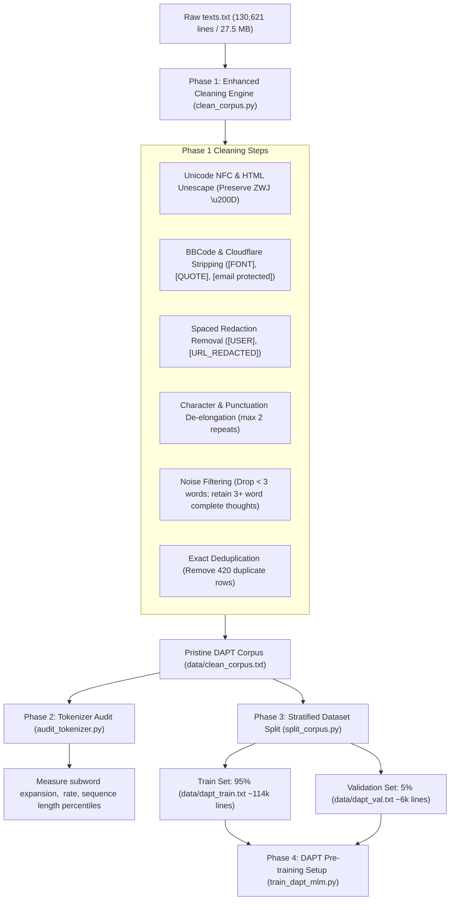

# Implementation Plan: Preprocessing & DAPT Preparation for XLM-RoBERTa

> **Document**: `implementation_plan.md`  
> **Source Corpus**: [`data/texts.txt`](file:///c:/Users/Lenovo/.gemini/antigravity-ide/scratch/sinhala_code_mixed_scraper/data/texts.txt) (130,621 lines, ~3.34M words)  
> **Target Architecture**: `xlm-roberta-base` Continued Pre-Training (Domain-Adaptive Pre-Training - DAPT / MLM)  
> **Domain**: Sinhala-English Code-Mixed & Romanized Singlish (Focus on First-Person Narratives, Emotional Experiences & Conversational Text)  
> **Reference Context**: [`chat_history.md`](file:///c:/Users/Lenovo/.gemini/antigravity-ide/brain/acfa070c-721d-432d-8642-d21fa164fdce/chat_history.md)

---

## 1. Executive Summary & Objective

The objective of this pipeline is to transform the expanded, raw web-scraped corpus ([`texts.txt`](file:///c:/Users/Lenovo/.gemini/antigravity-ide/scratch/sinhala_code_mixed_scraper/data/texts.txt)) into a high-quality, linguistically preserved dataset ready for **Masked Language Modeling (MLM)** pre-training on **XLM-RoBERTa (`xlm-roberta-base`)**.

Following the recent expansion of the corpus by **28,252 new records** (reaching **130,621 lines** and **~5.8M – 6.3M estimated subword tokens**), this plan incorporates the **5 critical linguistic and structural requirements** discovered during the latest diagnostic audit.



---

## 2. Baseline Corpus Diagnostic

The updated corpus in [`texts.txt`](file:///c:/Users/Lenovo/.gemini/antigravity-ide/scratch/sinhala_code_mixed_scraper/data/texts.txt) exhibits the following baseline profile:

| Metric | Raw Measured Value | Significance for XLM-RoBERTa |
| :--- | :--- | :--- |
| **Total Non-Empty Lines** | **130,621** | Optimal scale for domain adaptation without over-parameterization |
| **Total Words** | **3,342,565 (~3.34M)** | Substantially surpasses minimum empirical DAPT threshold (~2M tokens) |
| **Estimated Subwords** | **~5.8M – 6.3M tokens** | Sits in the recognized "golden window" for transformer adaptation |
| **File Size** | **27.45 MB** | In-memory processing is fast and lightweight |
| **Script: Pure Latin (Singlish)** | **103,623 lines (79.33%)** | Solves XLM-R's native blindspot regarding Romanized Sinhala morphology |
| **Script: Mixed Sinhala + Latin** | **26,998 lines (20.67%)** | Preserves cross-script grounding with Sinhala Unicode script |
| **Script: Pure Sinhala** | **0 lines (0.00%)** | Conforms strictly to code-mixing requirements |
| **Duplicate Lines** | **420 lines (0.32%)** | 99.68% uniqueness prior to cleaning |

---

## 3. Five Crucial Preprocessing Requirements Identified

The following 5 requirements address the exact failure modes discovered in the updated corpus:

### Requirement 1: Complete BBCode Tag Removal
* **Observation**: Forum formatting tags leaked into the scraped text, including `[FONT=&quot]`, `[/FONT]`, `[SIZE="4"]`, `[/SIZE]`, `[/QUOTE]`, and `[B]`.
* **Risk to XLM-R**: SentencePiece tokenizes `[FONT=&quot]` into 6 separate subwords (`_[` + `FONT` + `=` + `&` + `quot` + `]`), polluting MLM attention weights with synthetic markup.
* **Action**: Implement regex `re.compile(r'\[/?[a-zA-Z0-9_-]+(?:=[^\]]*)?\]')` to completely strip all BBCode tags.

### Requirement 2: Cloudflare Email Obfuscation Artifact Stripping
* **Observation**: Scraped forum comments containing user emails appear as `[email protected]`.
* **Risk to XLM-R**: Wastes token prediction budget on web proxy artifacts.
* **Action**: Explicitly match and strip `\[email protected\]`.

### Requirement 3: Spaced Redaction Substitution (Prevent Morpheme Fusing)
* **Observation**: Scraped text contains redaction tokens directly concatenated to Sinhala words (e.g., `[USER]ෙළයෙක්` or `[USER] White`).
* **Risk to XLM-R**: If `[USER]` is removed with an empty string `""`, the word collapses into `ෙළයෙක්` (an orphaned dependent vowel sign without a base consonant), triggering invalid Unicode sequences.
* **Action**: Substitute all redaction tags (`[USER]`, `[URL_REDACTED]`, `[PHONE_REDACTED]`, `[EMAIL_REDACTED]`) with a **single space `' '`**, followed by whitespace normalization.

### Requirement 4: Sinhala Zero-Width Joiner (`\u200D` - ZWJ) Preservation
* **Observation**: **5,017 lines** contain `\u200D` (ZWJ).
* **Linguistic Reality**: In Sinhala script, ZWJ is required for conjunct consonants and ligatures:
  * `ක්` + `\u200D` + `ෂ` = **ක්ෂ**
  * `ක්` + `\u200D` + `ර` = **ක්‍ර** (Rakaransaya)
  * `ර්` + `\u200D` + `ය` = **ර්‍ය** (Rephaya)
  * `ද්` + `\u200D` + `ය` = **ද්‍ය** (Yansaya, e.g., in `විද්‍යාව`)
* **Risk to XLM-R**: Naive cleaning (e.g., stripping non-printable ASCII or control characters `\p{C}`) removes `\u200D`. In live testing, `විද්‍යාව` (with ZWJ) tokenizes cleanly into **2 tokens**, while `විදයාව` (without ZWJ) corrupts and fragments into **3 tokens**.
* **Action**: Strictly protect `\u200D` while safely removing Byte Order Marks (BOM `\uFEFF`) and zero-width spaces (`\u200B`).

### Requirement 5: Selective Length Filtering (Preserve 3–4 Word Sentences)
* **Observation**:
  * **1 to 2 words (1,555 lines)**: Consist of forum bumps and one-word replies (`"bump machan"`, `"Patta! BUMP"`, `"ela kollek"`, `"Thanks machan"`).
  * **3 to 4 words (11,372 lines)**: Consist of authentic, grammatically complete Sinhala/Singlish expressions (`"mentally down වෙන්නැ."`, `"Help ekak demu..."`, `"ado paw bn."`, `"Vitz එකක් මදි වෙයිද"`).
* **Risk to XLM-R**: Dropping lines `< 5 words` discards over 11,000 valuable colloquial samples.
* **Action**: Set the minimum length threshold to **`>= 3 words`** (dropping the 1,555 low-information bumps, while preserving all 11,372 high-value short utterances).

---

## 4. Phase-by-Phase Implementation Specifications

### Phase 1: Enhanced Normalization & Cleaning Pipeline

* **Script**: [`clean_corpus.py`](file:///c:/Users/Lenovo/.gemini/antigravity-ide/scratch/sinhala_code_mixed_scraper/clean_corpus.py)
* **Input**: [`data/texts.txt`](file:///c:/Users/Lenovo/.gemini/antigravity-ide/scratch/sinhala_code_mixed_scraper/data/texts.txt)
* **Output**: `data/clean_corpus.txt`
* **Log / Audit Report**: `data/cleaning_audit_report.json`

#### Step-by-Step Execution Sequence:
1. **Encoding & BOM Cleanup**:
   - Read with `encoding='utf-8'`.
   - Strip leading UTF-8 BOM (`\uFEFF`) and zero-width spaces (`\u200B`), while preserving Sinhala ZWJ (`\u200D`).
2. **HTML Entity Decoding**:
   - Apply `html.unescape()` to decode entities like `&amp;` $\rightarrow$ `&`, `&quot;` $\rightarrow$ `"`, `&#039;` $\rightarrow$ `'`.
3. **Artifact & Markup Removal**:
   - Strip Cloudflare artifact: `\[email protected\]` $\rightarrow$ `' '`.
   - Strip BBCode tags: `\[/?[a-zA-Z0-9_-]+(?:=[^\]]*)?\]` $\rightarrow$ `' '`.
   - Strip redaction tokens: `\[(URL_REDACTED|USER|PHONE_REDACTED|EMAIL_REDACTED)\]` $\rightarrow$ `' '`.
   - Strip lingering raw URLs: `https?://\S+|www\.\S+` $\rightarrow$ `' '`.
   - Strip forum colon smilies: `:[a-zA-Z0-9_-]+:` $\rightarrow$ `' '`.
4. **Phonetic & Punctuation De-elongation**:
   - Collapse 3+ repeated characters to at most 2: `(.)\1{2,}` $\rightarrow$ `\1\1` (e.g., `aneeeeee` $\rightarrow$ `anee`, `nooooo` $\rightarrow$ `noo`).
   - Collapse repeated punctuation to at most 2: `([.!?,-])\1{2,}` $\rightarrow$ `\1\1` (e.g., `......` $\rightarrow$ `..`, `????` $\rightarrow$ `??`).
5. **Unicode NFC Normalization**:
   - Apply `unicodedata.normalize('NFC', text)` to standardize composite Sinhala vowel signs (*පිල්ලම්*).
6. **Whitespace Normalization**:
   - Collapse internal tabs, non-breaking spaces (`\u00A0`), and multiple spaces: `' '.join(text.split())`.
7. **Selective Length & Noise Filtering**:
   - Drop lines with `< 3 words` (eliminating one-word forum clutter like `"bump machan"`).
   - Drop lines under 12 characters.
   - Drop lines containing only numbers or punctuation.
8. **Corpus Deduplication**:
   - Track seen lines with a hash set and retain only unique records.

---

### Phase 2: XLM-R Tokenizer Audit & Sequence Profiling

* **Script**: [`audit_tokenizer.py`](file:///c:/Users/Lenovo/.gemini/antigravity-ide/scratch/sinhala_code_mixed_scraper/audit_tokenizer.py)
* **Input**: `data/clean_corpus.txt`
* **Output Report**: `data/tokenizer_audit_report.json`

#### Validation Metrics Checked:
1. **Unknown Token Rate (`<unk>`)**:
   - Must be $< 0.05\%$. (Verifies that SentencePiece handles all characters without falling back to `<unk>`).
2. **Subword Fragmentation Ratio**:
   - Measure: $\text{Ratio} = \frac{\text{Total Subwords}}{\text{Total Whitespace Words}}$.
   - Expected for Singlish/Code-Mixed: **1.3 – 1.8x**.
3. **Sequence Length Distribution**:
   - Compute P25, P50, P75, P90, P95, P99 token lengths.
   - **Optimization Decision**:
     - If P95 $\le 128$ tokens: Use `max_seq_length = 128` (yields 4x faster training and 50% lower VRAM usage).
     - If long narrative paragraphs dominate: Use `max_seq_length = 256`.

---

### Phase 3: Stratified Train / Validation Split

* **Script**: [`split_corpus.py`](file:///c:/Users/Lenovo/.gemini/antigravity-ide/scratch/sinhala_code_mixed_scraper/split_corpus.py)
* **Input**: `data/clean_corpus.txt`
* **Outputs**:
  * `data/dapt_train.txt` (95% $\approx$ 114,000 – 118,000 lines)
  * `data/dapt_val.txt` (5% $\approx$ 6,000 lines)

#### Why This Split is Scientifically Necessary:
During DAPT, running Masked Language Modeling on un-evaluated data risks **catastrophic forgetting** (where the model destroys its general multilingual representation).
* By evaluating every 500 or 1,000 steps on `dapt_val.txt`, we track:
  $$\text{Perplexity} = \exp(\mathcal{L}_{\text{val}})$$
* As long as $\text{Perplexity}$ decreases, the model is successfully acquiring Singlish and code-mixed morphology. If validation loss begins to rise, training is stopped early.

---

### Phase 4: Domain-Adaptive Pre-Training (DAPT) Execution Setup

* **Script**: [`train_dapt_mlm.py`](file:///c:/Users/Lenovo/.gemini/antigravity-ide/scratch/sinhala_code_mixed_scraper/train_dapt_mlm.py)
* **Base Model**: `xlm-roberta-base` (125M parameters)
* **Training Objective**: Masked Language Modeling (MLM) with dynamic 15% masking (`DataCollatorForLanguageModeling(mlm=True, mlm_probability=0.15)`).

#### Recommended Hyperparameter Grid:

| Hyperparameter | Value | Rationale |
| :--- | :--- | :--- |
| **Model** | `xlm-roberta-base` | Native Sinhala + English support; adapts rapidly to Singlish |
| **Max Sequence Length** | `128` (or `256`) | Captures >95% of forum comments without excessive padding |
| **Per-Device Batch Size** | `16` – `32` | Depends on available VRAM (8GB vs 16GB) |
| **Gradient Accumulation** | `2` – `4` | Ensures an effective batch size of $64 – 128$ |
| **Learning Rate** | $2.5 \times 10^{-5}$ | Conservative rate to prevent forgetting base weights |
| **LR Scheduler** | Cosine with linear warmup | 10% warmup steps |
| **Weight Decay** | `0.01` (AdamW) | Regularization |
| **Precision** | `fp16` (or `bf16` on Ampere+) | Speeds up training by ~2.5x |
| **Epochs** | `3` to `5` | Adequate for ~6M tokens |
| **Evaluation Strategy** | Steps (every 1,000 steps) | Early stopping if validation loss plateaus |

---

## 5. Verification Checklist & Success Criteria

Before moving from Phase 1 to Phase 4, the following criteria must pass:

- [ ] **Zero BBCode Tags**: Regex check returns 0 matches for `\[/?[a-zA-Z0-9]+.*?\]`.
- [ ] **Zero Cloudflare Tags**: 0 matches for `\[email protected\]`.
- [ ] **Zero Redaction Brackets**: 0 occurrences of `[USER]`, `[URL_REDACTED]`, `[PHONE_REDACTED]`.
- [ ] **Sinhala ZWJ Preserved**: Verification script confirms `\u200D` remains intact in Sinhala words.
- [ ] **No Micro-Bumps**: 0 lines with $< 3$ words.
- [ ] **Duplicate Count = 0**: Set-difference confirms 100% unique lines in `clean_corpus.txt`.
- [ ] **XLM-R `<unk>` Rate < 0.05%**: Confirmed via `AutoTokenizer`.
- [ ] **Clean Split Generated**: `dapt_train.txt` and `dapt_val.txt` are populated and non-overlapping.

---

## 6. Execution Command Summary

When instructed to execute, the pipeline runs via three modular CLI steps:

```powershell
# Step 1: Run Enhanced Cleaning Engine
python clean_corpus.py --input data/texts.txt --output data/clean_corpus.txt

# Step 2: Run Tokenizer Audit & Metric Verification
python audit_tokenizer.py --input data/clean_corpus.txt

# Step 3: Split into Train & Validation Sets
python split_corpus.py --input data/clean_corpus.txt --train-ratio 0.95
```
