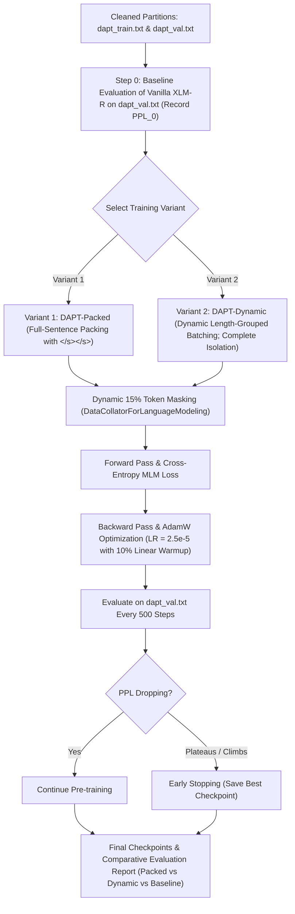

# Phase 4 Blueprint: Domain-Adaptive Pre-Training (DAPT) on XLM-RoBERTa

> **Document**: `phase_4_dapt_plan.md`  
> **Target Architecture**: `xlm-roberta-base` (125M parameters, 12 layers, 768 hidden dimension, 12 attention heads)  
> **Training Objective**: Masked Language Modeling (MLM) with dynamic 15% token masking  
> **Execution Environment**: **Google Colab (Free Cloud T4 GPU - 15GB VRAM)**  
> **Training Strategy**: **Full-Weight DAPT (Option A)** with **Dual-Variant Ablation Study**  
> **Sequence Length**: **`max_seq_length = 256`**  
> **Input Partitions**:
> - Train Set: [`data/adaptation/dapt_train.txt`](file:///d:/J26-SE-338/research/c3-model-experiments/data/adaptation/dapt_train.txt) (121,913 sentences, ~3.15M words, ~5.93M subwords)
> - Validation Set: [`data/adaptation/dapt_val.txt`](file:///d:/J26-SE-338/research/c3-model-experiments/data/adaptation/dapt_val.txt) (6,416 sentences, ~177k words, ~334k subwords)  
> **Domain**: Sinhala-English Code-Mixed & Romanized Singlish (79.2% Singlish, 20.2% Mixed Sinhala Script)  
> **Academic Reference**: *Gururangan et al., "Don't Stop Pretraining: Adapt Language Models to Domains and Tasks", ACL 2020.*

---

## 1. What Exactly Happens in Phase 4?

Phase 4 is the **core machine learning pre-training stage** of your domain adaptation pipeline.

Up to this point, off-the-shelf `xlm-roberta-base` has primarily seen standard text from Common Crawl. When presented with informal Sri Lankan discourse like:
> `"mata stress eka wadi wela night sleep ganna ba, full depressed inne"`

its internal self-attention representations are suboptimal because it has never observed Romanized Singlish morphology (`wela`, `ganna`, `inne`, `nisa`) in context.

In Phase 4, we perform **Domain-Adaptive Continued Pre-Training (DAPT)** via Masked Language Modeling:
1. **Baseline Pre-Evaluation ($PPL_0$)**: Before any training, vanilla `xlm-roberta-base` is evaluated zero-shot on [`dapt_val.txt`](file:///d:/J26-SE-338/research/c3-model-experiments/data/adaptation/dapt_val.txt) to record its baseline perplexity.
2. **Dynamic 15% Masking**: During training, 15% of subwords in each input batch are randomly masked (80% `<mask\>`, 10% random subword, 10% unchanged).
3. **Contextual Recovery**: The self-attention layers process the bidirectional Sinhala and English context to predict the masked tokens.
4. **Iterative Optimization**: Over 3–4 epochs across ~5.93 Million subwords, the model aligns the contextual embeddings of fragmented subwords into cohesive semantic representations.



---

## 2. Dual-Variant Experimental Design (Ablation Study)

To rigorously investigate the impact of cross-sentence attention interaction during sequence packing, Phase 4 trains **two separate DAPT model variants** for downstream comparison:

| Dimension | Variant 1: `DAPT-Packed` (Strategy 1) | Variant 2: `DAPT-Dynamic` (Strategy 3) |
| :--- | :--- | :--- |
| **Data Organization** | **Full-Sentence Packing**: Multiple sentences concatenated with `</s></s>` delimiters up to a fixed 256-token buffer. | **Dynamic Length-Grouped Batching**: Sentences of similar lengths are grouped into batches (`group_by_length=True`). **No concatenation.** |
| **Cross-Sentence Attention** | Tokens can compute cross-sentence attention across `</s></s>` boundaries. | **Zero** cross-sentence attention. Each sentence is a strictly isolated tensor. |
| **Padding Waste** | **0% padding**. Every token in the 256-token block is content or `</s>`. | Padding is added dynamically only to the longest sequence in that specific mini-batch. |
| **Throughput / Speed** | **Fastest** (~20–25 min on Colab T4 for 3 epochs). | ~28–35 min on Colab T4 for 3 epochs. |
| **Output Model Path** | `models/xlm-roberta-dapt-packed/` | `models/xlm-roberta-dapt-dynamic/` |
| **Research Value** | Tests standard RoBERTa packing scalability. | Tests whether strict conversational isolation yields cleaner representations. |

---

## 3. Scientific Verification: Baseline Evaluation Protocol ($PPL_0$)

To prove conclusively that the model learned domain syntax and vocabulary, we implement a **Pre-Training Control Benchmark**:

1. **Step 0 (Zero-Shot Baseline)**:
   * Load the un-adapted, off-the-shelf `xlm-roberta-base`.
   * Evaluate validation loss on [`dapt_val.txt`](file:///d:/J26-SE-338/research/c3-model-experiments/data/adaptation/dapt_val.txt) without any weight updates.
   * Calculate baseline perplexity:
     $$PPL_{\text{base}} = \exp(\mathcal{L}_{\text{val\_base}})$$
   * Expected baseline value on code-mixed/Singlish text: **~85 to 140** (high uncertainty).

2. **Post-DAPT Evaluation**:
   * Calculate final perplexity for both variants: $PPL_{\text{packed}}$ and $PPL_{\text{dynamic}}$.
   * Expected adapted value: **~18 to 35**.

3. **Quantifiable Improvement Proof**:
   $$\Delta \text{PPL} = PPL_{\text{base}} - PPL_{\text{DAPT}} \quad \text{and} \quad \% \text{ PPL Reduction} = \frac{PPL_{\text{base}} - PPL_{\text{DAPT}}}{PPL_{\text{base}}} \times 100\%$$
   This delivers irrefutable mathematical evidence of domain learning for publication.

---

## 4. Exact Evaluation & Validation Metrics Produced in Phase 4

Phase 4 generates comprehensive quantitative and qualitative evaluation metrics:

| Metric / Measurement | Scope & Frequency | Purpose & Interpretation |
| :--- | :--- | :--- |
| **$\mathcal{L}_{\text{train}}$ (Training MLM Loss)** | Logged every 50–100 steps | Tracks smooth gradient descent across training batches. |
| **$\mathcal{L}_{\text{val}}$ (Validation MLM Loss)** | Evaluated every 500 steps on `dapt_val.txt` | Measures generalizability on held-out code-mixed sentences. |
| **$\text{PPL}$ (Domain Perplexity)** | Computed every 500 steps ($e^{\mathcal{L}_{\text{val}}}$) | Measures the average uncertainty of the model when predicting domain tokens. Lower is better. |
| **$\Delta \text{PPL}$ & % Reduction** | Computed at completion vs $PPL_{\text{base}}$ | Proves domain acquisition delta compared to vanilla XLM-R. |
| **Top-1 & Top-5 Masked Token Accuracy** | Evaluated on validation set | Percentage of masked tokens correctly predicted in the top 1 and top 5 model candidates. |
| **Training Dynamics** | Steps/sec, tokens/sec, total runtime, peak VRAM | Hardware throughput and computational efficiency profiling. |
| **Qualitative Mask Prediction Diffs** | Sampled on 20 held-out sentences | Side-by-side inspection: True token vs Baseline prediction vs Packed prediction vs Dynamic prediction. |

---

## 5. Hyperparameter Configuration Grid (Colab T4 Optimized)

Both variants will be trained using the exact same hyperparameter foundation to ensure a controlled comparison:

| Hyperparameter | Configured Value | Rationale |
| :--- | :--- | :--- |
| **Base Model** | `xlm-roberta-base` (125M params) | Foundation multilingual encoder |
| **Max Sequence Length** | **256** | Accommodates 97.85% of sentences in full |
| **Masking Probability** | **15% (Dynamic MLM)** | Standard BERT/RoBERTa masking ratio |
| **Per-Device Batch Size** | **16** | Fits comfortably within T4 15GB VRAM |
| **Gradient Accumulation Steps** | **4** | Effective batch size = $16 \times 4 = \mathbf{64}$ sequences / step |
| **Effective Token Batch Size** | ~16,384 tokens / step (Packed) | Stable gradient descent |
| **Learning Rate** | **$2.5 \times 10^{-5}$** | Conservative rate protecting base multilingual weights |
| **LR Scheduler** | **Cosine Decay with 10% Linear Warmup** | Ramps up smoothly over first ~100 steps |
| **Optimizer** | **AdamW** ($\beta_1=0.9, \beta_2=0.98, \epsilon=10^{-6}$) | Standard transformer optimizer |
| **Weight Decay** | **0.01** | L2 weight regularization |
| **Precision** | **Mixed Precision (`fp16`)** | 2.5x throughput speedup on NVIDIA T4 Tensor Cores |
| **Epochs** | **3 to 4 epochs** | Early stopping if validation loss plateaus for 3 evaluation checks |
| **Evaluation / Save Interval** | **Every 500 steps** | Saves best checkpoint based on lowest validation loss |

---

## 6. Directory Structure & Generated Artifacts

Phase 4 creates and outputs the following modular structure in your repository:

```text
d:\J26-SE-338\research\c3-model-experiments\
├── src/
│   └── train_dapt_mlm.py                          # Unified training script supporting --strategy packed|dynamic
├── notebooks/
│   └── 04_dapt_pretraining_colab.ipynb            # Google Colab execution notebook with free T4 GPU support
├── results/
│   └── dapt/
│       ├── baseline_evaluation.json               # Vanilla XLM-R zero-shot metrics on dapt_val.txt
│       ├── metrics_packed.json                    # Variant 1 training & evaluation logs
│       ├── metrics_dynamic.json                   # Variant 2 training & evaluation logs
│       ├── dapt_ablation_summary.json             # Direct side-by-side comparison table
│       ├── dapt_loss_curves.png                   # Publication plot: Step vs Loss & Perplexity (Packed vs Dynamic)
│       └── qualitative_prediction_samples.json    # Sample masked predictions (Base vs Packed vs Dynamic)
└── models/
    ├── xlm-roberta-dapt-packed/                   # Variant 1 adapted model weights & tokenizer
    │   ├── config.json
    │   ├── model.safetensors
    │   └── tokenizer.json
    └── xlm-roberta-dapt-dynamic/                  # Variant 2 adapted model weights & tokenizer
        ├── config.json
        ├── model.safetensors
        └── tokenizer.json
```

---

## 7. Downstream Integration (Stage B Task Benchmark)

Once Phase 4 completes, both `xlm-roberta-dapt-packed` and `xlm-roberta-dapt-dynamic` will be evaluated alongside baseline `xlm-roberta-base` on your student video comments / code-mixed mental health emotion classification tasks (Stage B). This completes the scientific cycle, demonstrating the empirical advantage of domain-adaptive pre-training.
